# Primeiros passos

**O que você vai fazer:** conhecer o sistema, criar sua conta, entrar e cuidar da sua senha.
**Quem pode fazer:** todos os perfis.

## O que é o FertilizaCerrado

O FertilizaCerrado acompanha a lavoura de soja do Cerrado, talhão por talhão. Você informa onde fica o talhão e quando a cultura emergiu. O sistema busca os dados de clima daquele ponto e calcula, dia a dia, quanta água a planta precisou e quanta ela realmente teve.

Com isso, o sistema mostra em que momentos do ciclo a lavoura sofreu falta de água e quanto isso pode custar em produtividade. A partir daí ele estima a produtividade da safra em comparação com a produtividade potencial que você informou.

Nesta versão o sistema entrega:

- cadastro de propriedades e de talhões desenhados no mapa;
- cadastro de cultivares e de safras;
- o painel agrometeorológico, que é o coração do sistema e está no [capítulo 6](06-painel-agrometeorologico.md);
- as telas de administração.

> **Importante.** O sistema apoia e não substitui a decisão do responsável técnico. Os números são estimativas feitas a partir de dados de clima e dos parâmetros que você informa.

Algumas siglas aparecem nas telas. Todas estão explicadas no [glossário](08-perguntas-e-glossario.md#glossário).

## Os três perfis

Cada pessoa entra no sistema com um perfil. O perfil define o que ela enxerga e o que pode alterar.

| Perfil | O que enxerga | O que pode fazer |
|---|---|---|
| **Agrônomo** | As propriedades que cadastrou ou que acompanha | Cadastrar e editar propriedades, talhões, cultivares e safras. Pedir o processamento e informar a produtividade potencial da safra. |
| **Produtor** | Somente as suas propriedades | Consultar tudo o que é seu. Não altera nada. |
| **Administrador** | Tudo | Tudo o que o agrônomo faz, mais gerenciar usuários e as rotinas de dados do [capítulo 7](07-administracao.md). |

Agrônomos e produtores criam a própria conta. A conta de administrador é criada pela equipe que instala o sistema.

## Criar sua conta

1. Abra o endereço do sistema no navegador. Aparece a tela **Entrar**. Clique em **Cadastre-se**, logo abaixo do formulário.

   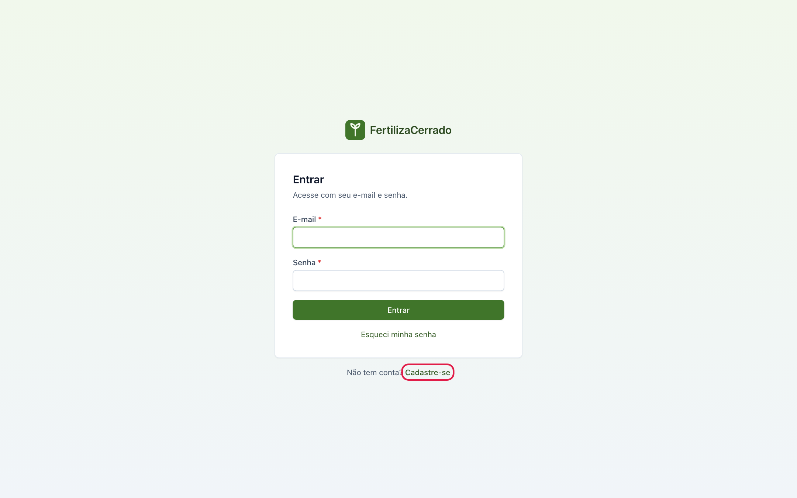

2. Preencha o formulário **Criar conta**.

   - **Perfil:** escolha **Agrônomo(a)** ou **Produtor(a)**.
   - **Nome** e **E-mail:** o e-mail será o seu usuário de acesso.
   - **Senha:** precisa ter pelo menos 8 caracteres, uma letra maiúscula, um número e um caractere especial. A lista abaixo do campo marca com ✓ cada regra cumprida.
   - **Tipo de pessoa:** pessoa física, com CPF, ou pessoa jurídica, com CNPJ.
   - **CREA** e **Telefone** são opcionais. O campo CREA só aparece para agrônomos.

   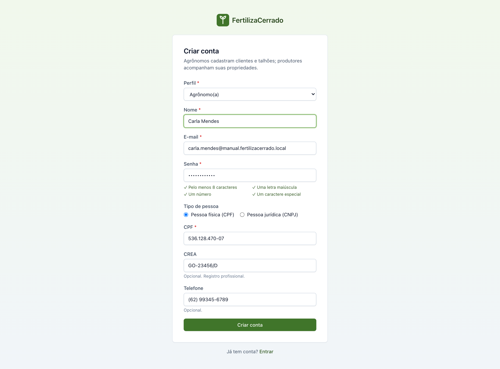

3. Clique em **Criar conta**. O sistema mostra a tela **Verifique seu e-mail** e envia um link de confirmação para o endereço informado.

   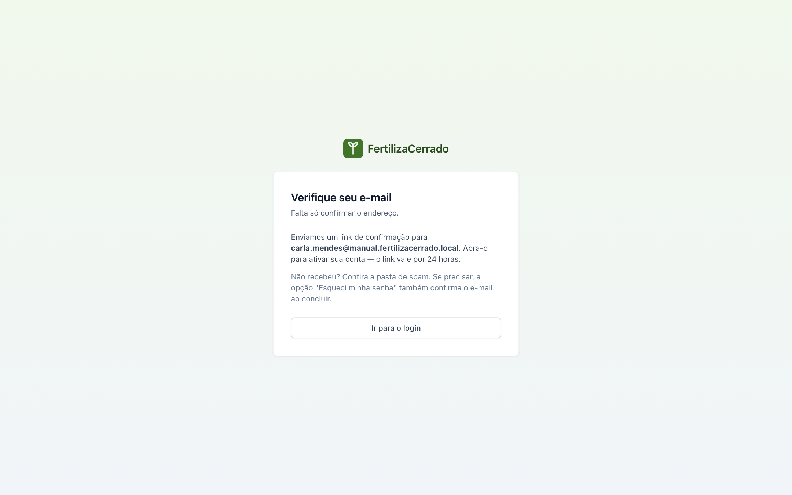

## Confirmar o e-mail

A conta só funciona depois de confirmada. O link vale por 24 horas.

1. Abra a mensagem recebida e clique no link. Se não a encontrar, olhe a pasta de spam.

2. O sistema mostra **E-mail verificado! Sua conta está ativa.** Clique em **Ir para o login**.

   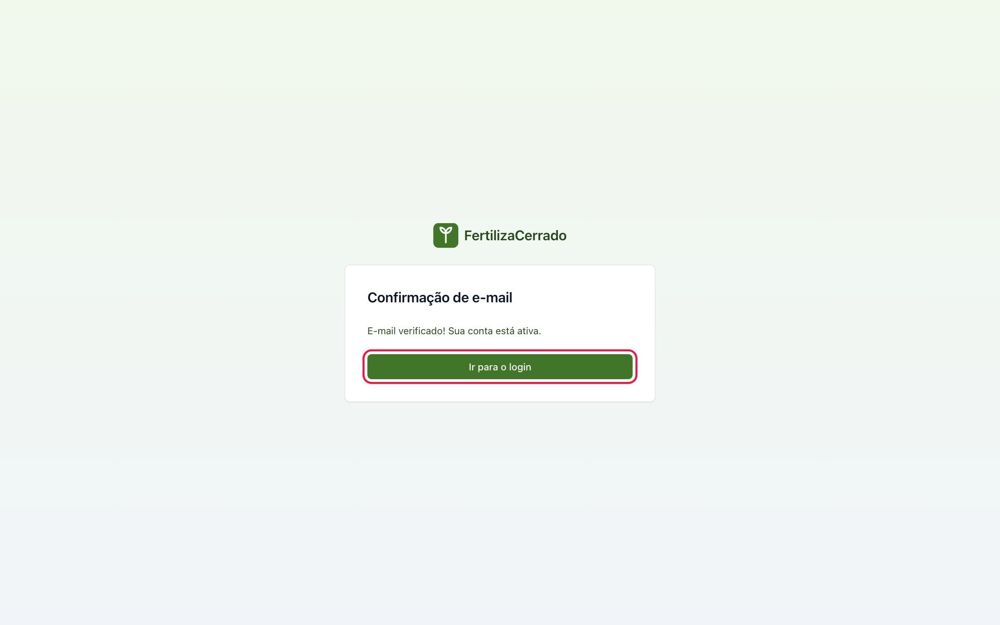

**Se você tentar entrar antes de confirmar**, o sistema avisa que o e-mail ainda não foi verificado e mostra o botão **Reenviar e-mail de verificação**. Clique nele para receber um link novo. O reenvio é limitado a três pedidos por hora.

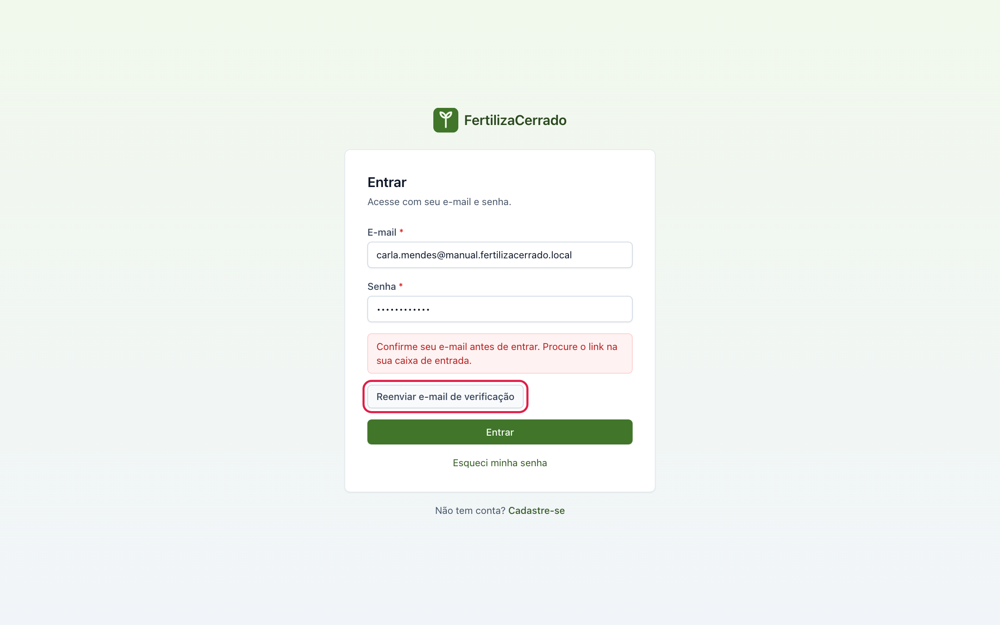

## Entrar no sistema

1. Na tela **Entrar**, informe **E-mail** e **Senha** e clique em **Entrar**.

2. O sistema abre a tela **Propriedades**. À esquerda fica o menu, com **Propriedades**, **Talhões**, **Safras** e **Cultivares**. No canto superior direito ficam o seu nome, o seu perfil e o botão **Sair**.

   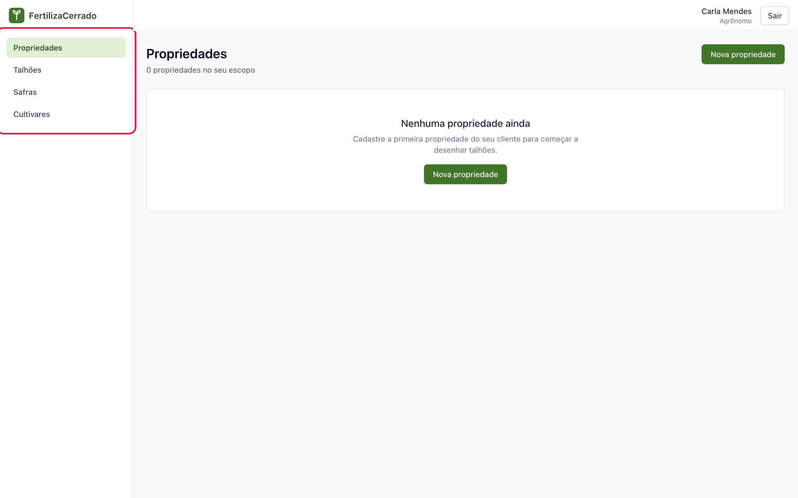

Depois de cinco tentativas com a senha errada, o sistema bloqueia novas tentativas por até 15 minutos e mostra quanto tempo falta. Espere esse tempo ou use a recuperação de senha.

Para encerrar o uso, clique em **Sair**. Faça isso sempre que usar um computador compartilhado.

## Ver e alterar seus dados

1. Clique no seu nome, no canto superior direito.

   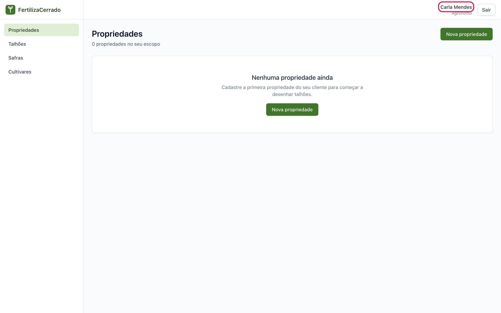

2. A tela **Meu perfil** mostra o seu e-mail, o seu perfil e se o e-mail está verificado. Em **Dados pessoais** você altera **Nome**, **Telefone** e **CREA**. Clique em **Salvar** para gravar.

   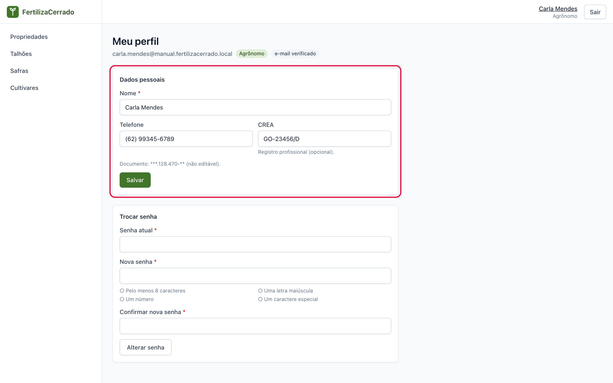

O e-mail e o documento não podem ser alterados. Se algum deles estiver errado, fale com o administrador.

## Trocar a senha

1. Na tela **Meu perfil**, vá até a seção **Trocar senha**.

2. Informe a **Senha atual**, a **Nova senha** e repita a nova em **Confirmar nova senha**. A nova senha segue as mesmas regras do cadastro.

   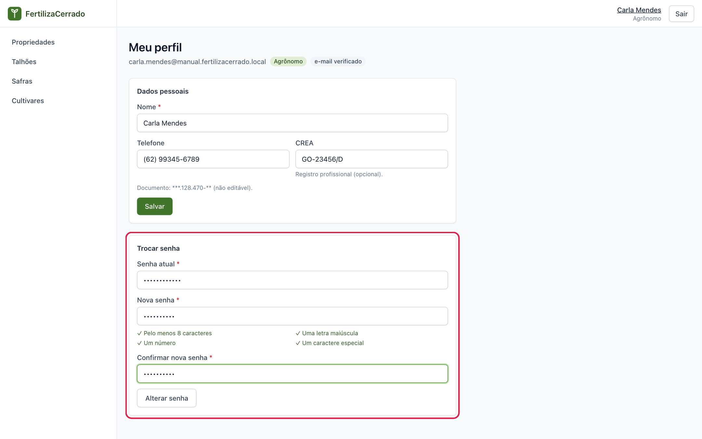

3. Clique em **Alterar senha**. Aparece a mensagem **Senha alterada com sucesso.** Os outros aparelhos em que você estava conectado são desconectados.

## Esqueci minha senha

1. Na tela **Entrar**, clique em **Esqueci minha senha**.

   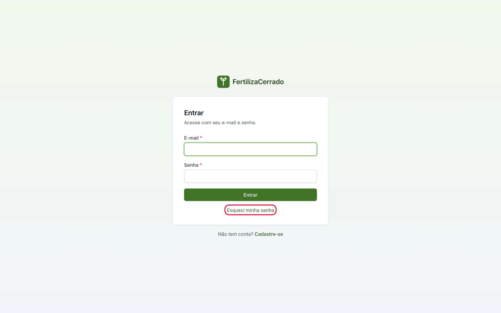

2. Informe o e-mail da conta e clique em **Enviar link**.

   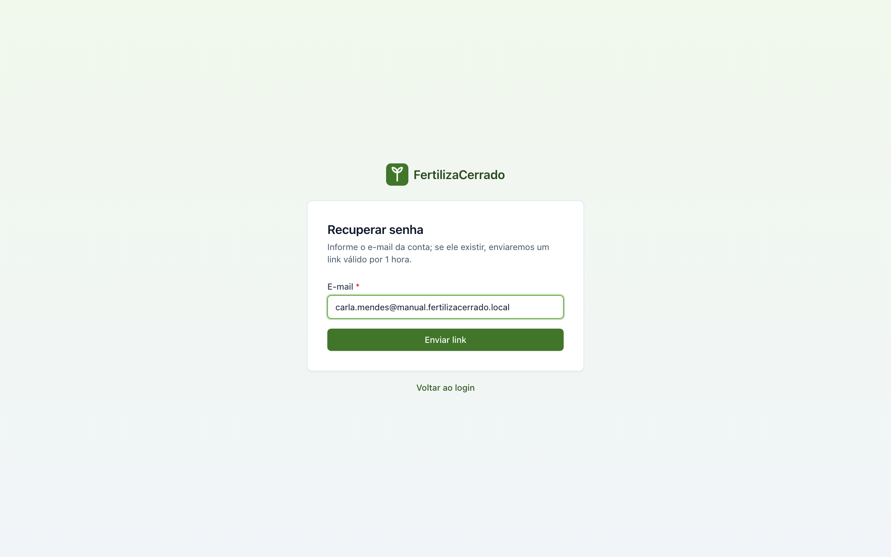

3. O sistema informa que, se houver uma conta com aquele e-mail, o link será enviado. A mensagem é a mesma quando o e-mail não existe. Isso é proposital e protege os dados dos usuários.

   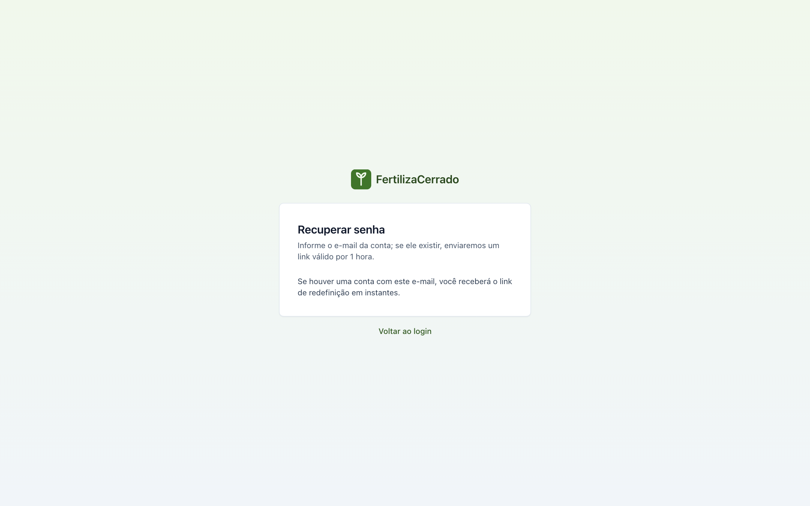

4. Abra a mensagem recebida e clique no link. Ele vale por 1 hora. Na tela **Redefinir senha**, digite a nova senha duas vezes e clique em **Redefinir senha**.

   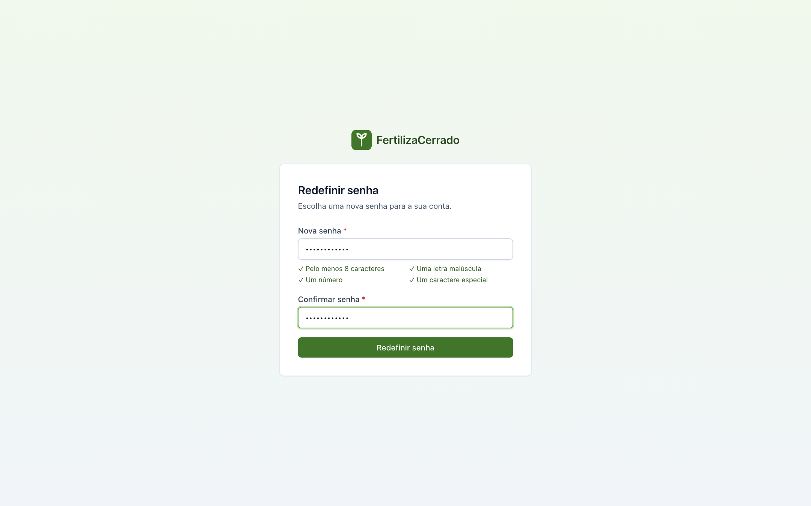

5. Aparece **Senha redefinida com sucesso.** Clique em **Entrar** e acesse com a nova senha.

   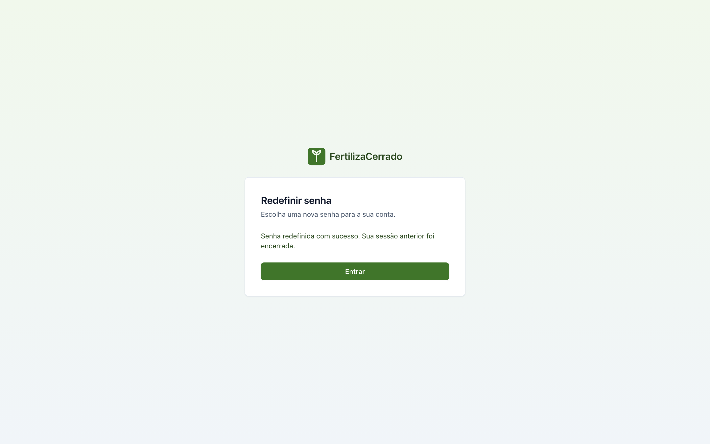

Concluir a recuperação de senha também confirma o e-mail. É uma saída quando o link de confirmação venceu.

## Se a sua conta estiver desativada

Se ao entrar aparecer o aviso de que a conta está desativada, só um administrador pode reativá-la. Os seus dados continuam guardados.

---

Próximo capítulo: [Propriedades](02-propriedades.md)
