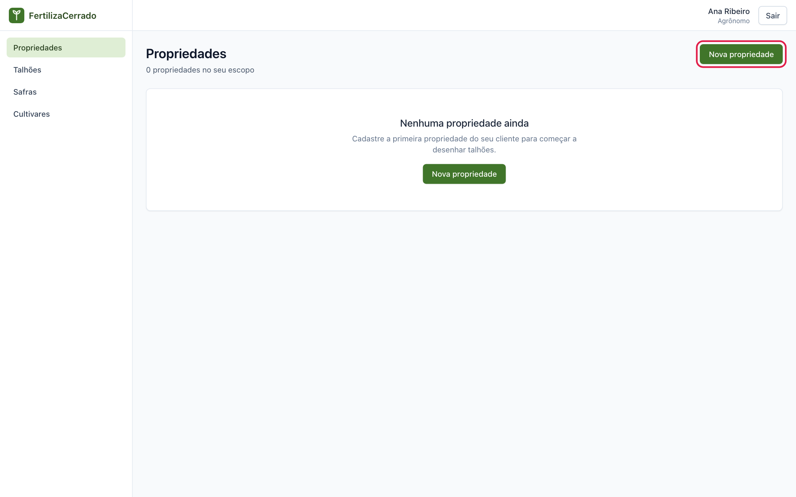
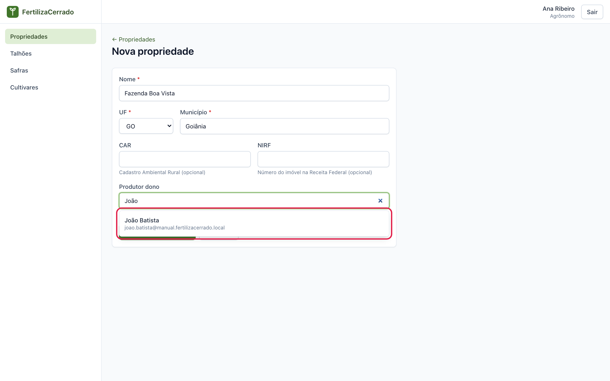
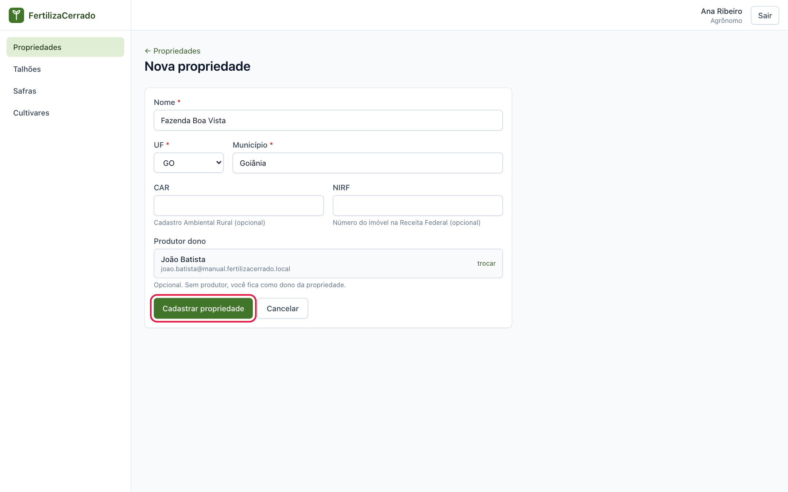
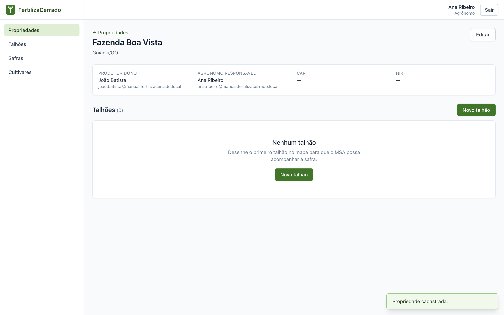
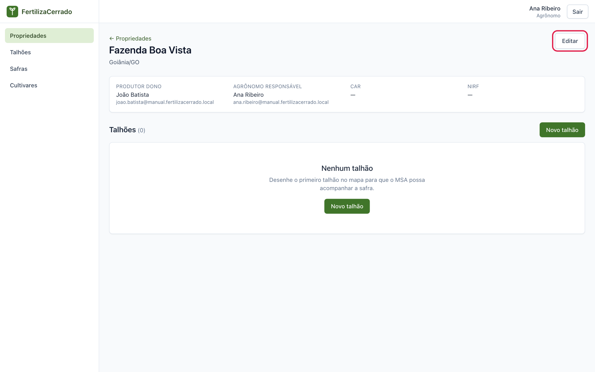
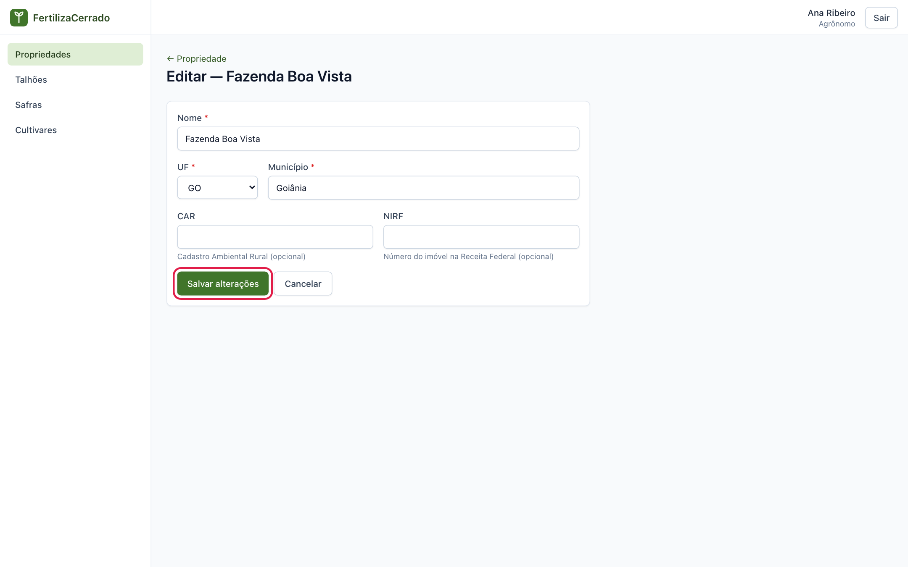
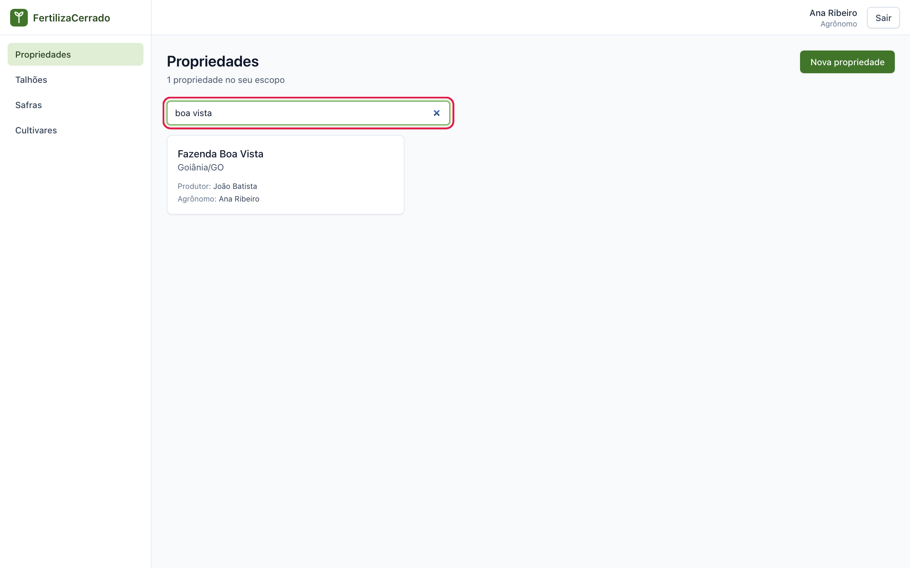
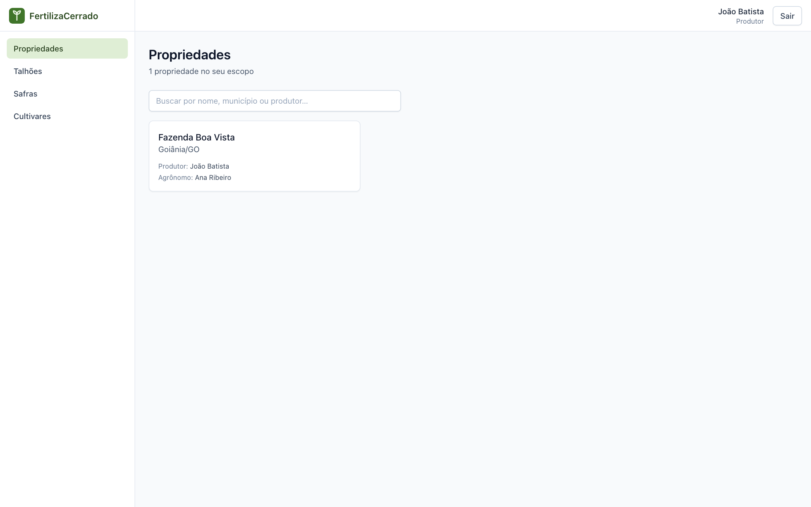

# Propriedades

**O que você vai fazer:** cadastrar uma propriedade rural, ligá-la ao produtor, corrigir os dados e consultá-la.
**Quem pode fazer:** agrônomo e administrador cadastram e editam. O produtor apenas consulta.

A propriedade é a fazenda. Dentro dela ficam os talhões, e é nos talhões que as safras são acompanhadas. Por isso o cadastro começa aqui.

## Cadastrar uma propriedade

1. No menu, clique em **Propriedades**. Depois clique em **Nova propriedade**.

   

2. Preencha **Nome**, **UF** e **Município**. Os campos **CAR**, o Cadastro Ambiental Rural, e **NIRF**, o número do imóvel na Receita Federal, são opcionais.

3. Em **Produtor dono**, digite pelo menos três letras do nome ou do e-mail do produtor. O sistema lista as contas de produtor encontradas. Clique na pessoa certa.

   

   O produtor precisa ter conta no sistema. Se ele ainda não tem, peça que se cadastre com o perfil **Produtor(a)**, como mostra o [capítulo 1](01-primeiros-passos.md#criar-sua-conta).

   Para o agrônomo este campo é opcional. Deixando em branco, você mesmo fica como dono da propriedade. Para o administrador o campo é obrigatório.

4. Confira os dados e clique em **Cadastrar propriedade**.

   

5. O sistema abre a página da propriedade. Ela mostra o produtor dono, o agrônomo responsável, que é você, e a lista de talhões, ainda vazia.

   

O próximo passo é desenhar os talhões. Veja o [capítulo 3](03-talhoes.md).

## Editar uma propriedade

1. Abra a propriedade e clique em **Editar**.

   

2. Altere o que for preciso e clique em **Salvar alterações**. Para desistir, clique em **Cancelar**.

   

Só o administrador pode trocar o produtor dono de uma propriedade já cadastrada. Também só ele vê o botão **Excluir**. A exclusão faz a propriedade deixar de aparecer para todos os usuários.

## Consultar as propriedades

No menu, clique em **Propriedades**. Cada cartão mostra o nome, o município, o produtor, o agrônomo e a quantidade de talhões.

Use o campo de busca para filtrar por nome, município ou produtor. A busca ignora acentos e maiúsculas. Clique em um cartão para abrir a propriedade.

## O que o produtor vê

O produtor enxerga apenas as propriedades em que é o dono. Ele abre a propriedade, os talhões, as safras e o painel, mas não encontra os botões de cadastrar, editar ou excluir.

---

Capítulo anterior: [Primeiros passos](01-primeiros-passos.md) · Próximo: [Talhões](03-talhoes.md)
