# Talhões

**O que você vai fazer:** desenhar um talhão no mapa e informar os dados de que o sistema precisa para acompanhar a safra.
**Quem pode fazer:** agrônomo e administrador. O produtor apenas consulta.

O talhão é a área de lavoura que recebe uma safra. O sistema usa o desenho do talhão para saber de onde buscar os dados de clima. Um talhão mal posicionado recebe o clima do lugar errado, então vale desenhar com cuidado.

## Abrir o cadastro de talhão

1. Abra a propriedade e clique em **Novo talhão**.

   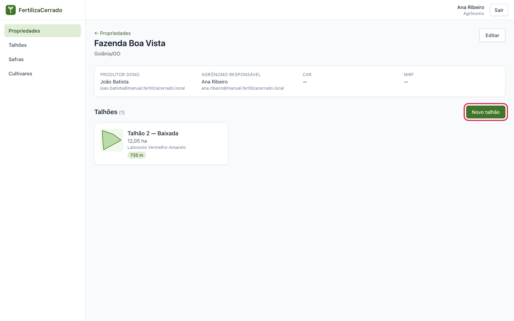

2. A tela **Novo talhão** tem o mapa à esquerda e os dados do talhão à direita.

## Conhecer o mapa

As ferramentas de desenho ficam no canto superior esquerdo do mapa, de cima para baixo:

- **+** e **−** aproximam e afastam. A roda do mouse faz o mesmo.
- **Retângulo** e **polígono** desenham o talhão.
- **Editar** permite mover os cantos do desenho.
- **Arrastar** move o desenho inteiro.
- **Borracha** apaga o desenho.

Para mover o mapa, clique nele e arraste.

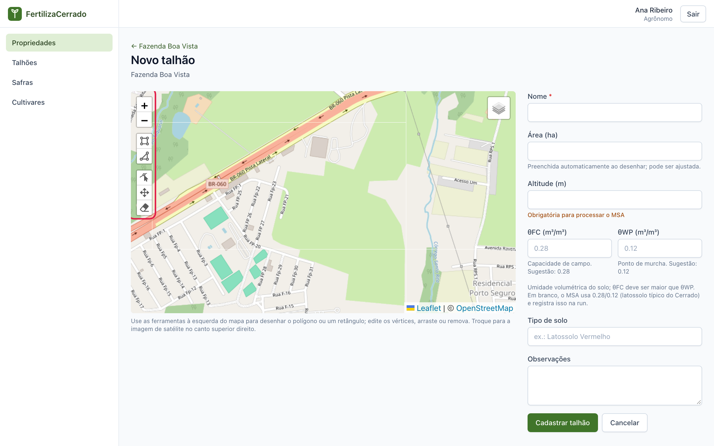

### Mapa ou imagem de satélite

O mapa abre com ruas e estradas. Para enxergar a lavoura, passe o mouse sobre o ícone de camadas, no canto superior direito, e escolha **Imagem de satélite (Esri)**. Para voltar, escolha **Mapa (OpenStreetMap)**.

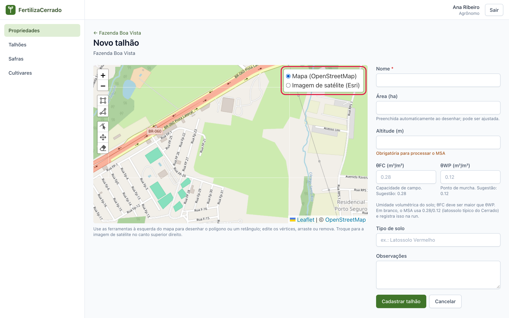

Use o mapa para se localizar pelas estradas e a imagem de satélite para contornar o talhão.

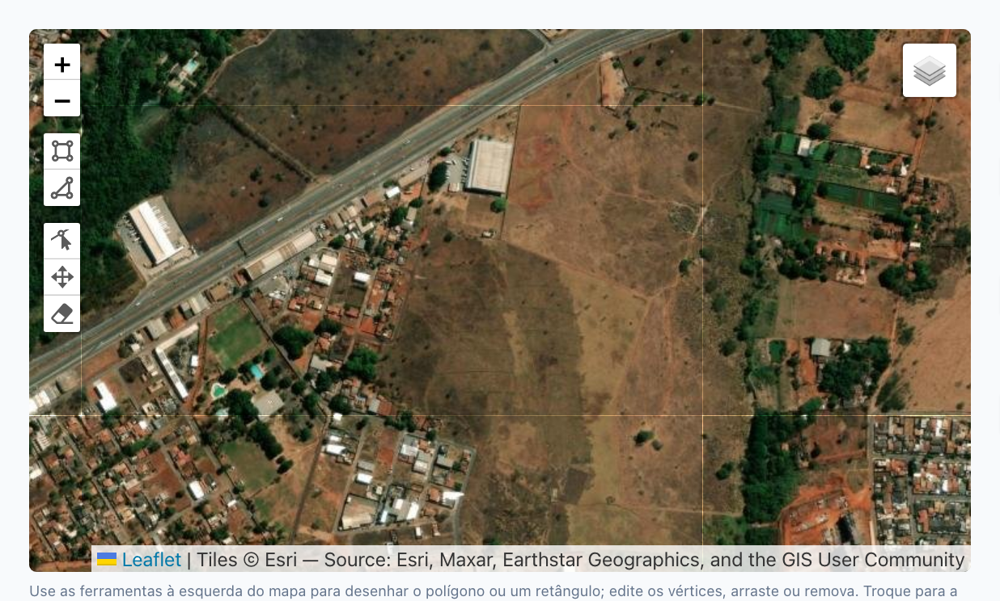

A imagem de satélite pode ter alguns anos. Confira se as divisas ainda são as mesmas.

## Desenhar o talhão

1. Aproxime o mapa até ver bem as divisas. Clique na ferramenta **polígono**.

2. Clique em cada canto do talhão, seguindo a divisa sempre no mesmo sentido. A cada clique o sistema liga o novo ponto ao anterior.

   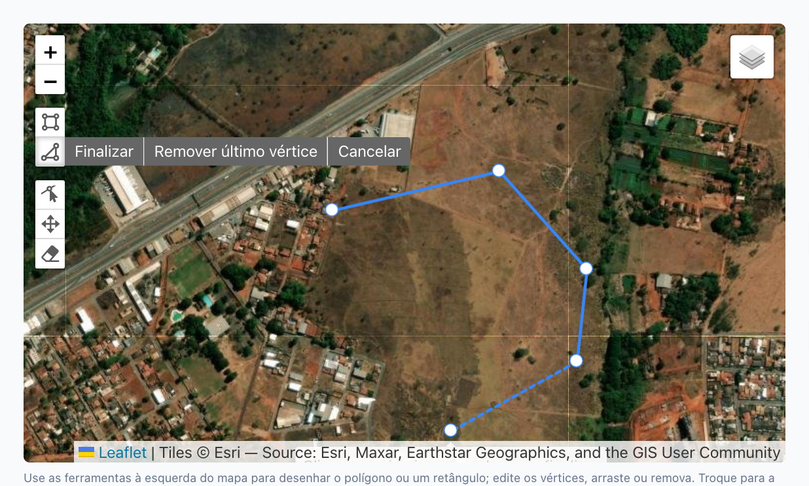

3. Para fechar, clique de novo no primeiro ponto. O talhão fica pintado de verde e o campo **Área (ha)** é preenchido sozinho, em hectares.

   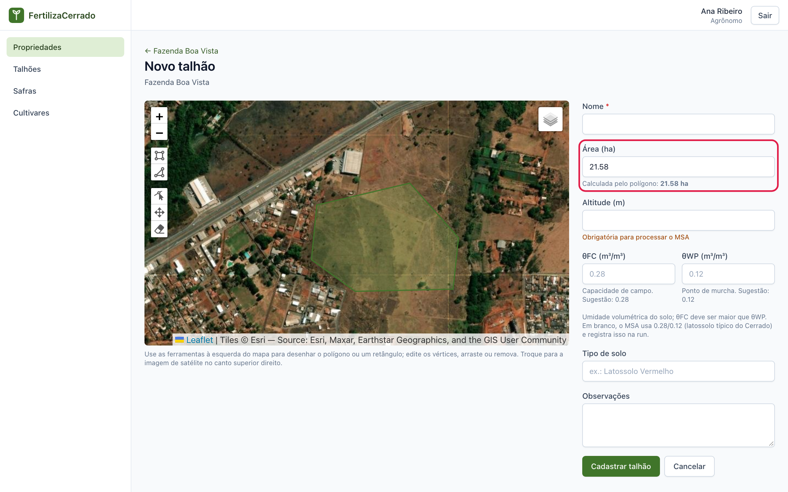

Para um talhão retangular, a ferramenta **retângulo** é mais rápida: clique em um canto e depois no canto oposto.

### Corrigir o desenho

Clique na ferramenta **editar**. Aparecem pontos em cada canto e no meio de cada lado. Arraste um canto para movê-lo. Arraste um ponto do meio de um lado para criar um canto novo. Clique de novo em **editar** para terminar.

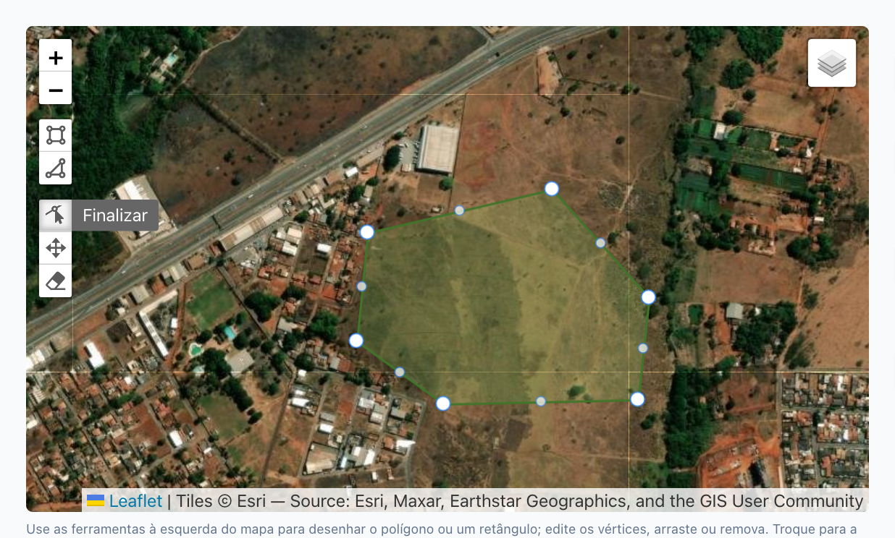

Cada talhão tem um único desenho. Se você desenhar outro, o sistema pergunta se quer substituir o anterior.

## Informar os dados do talhão

### Nome e área

Dê um **Nome** que você reconheça no campo. A **Área (ha)** vem do desenho. Você pode digitar outro valor se tiver a medida oficial. Para voltar ao valor do desenho, clique em **usar a calculada**, que aparece abaixo do campo.

### Altitude

Informe a **Altitude (m)** do talhão, em metros acima do nível do mar.

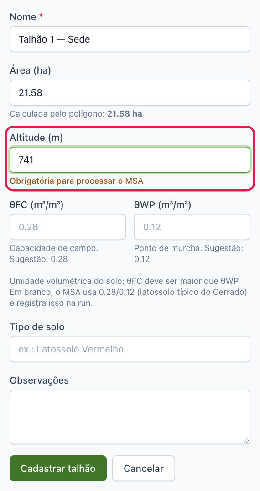

**Por que a altitude é obrigatória.** O sistema calcula quanta água a lavoura perde para a atmosfera. Esse cálculo depende da pressão do ar, e a pressão muda com a altitude. Sem a altitude a conta não fecha, e o sistema não processa a safra daquele talhão.

Você encontra a altitude no GPS, no aplicativo de mapas do celular ou no levantamento topográfico da fazenda. Um erro de algumas dezenas de metros muda pouco o resultado.

### Umidade do solo

Os campos **θFC** e **θWP** descrevem quanta água o solo do talhão consegue guardar.

- **θFC, capacidade de campo:** a água que fica no solo depois que o excesso de uma chuva forte escorre. É o reservatório cheio.
- **θWP, ponto de murcha:** a água que sobra quando a planta já não consegue tirar mais nada do solo. É o reservatório vazio.

A diferença entre os dois é a água que a planta pode usar. Os valores são frações de volume: 0,28 quer dizer 28% do volume do solo ocupado por água. A capacidade de campo é sempre maior que o ponto de murcha.

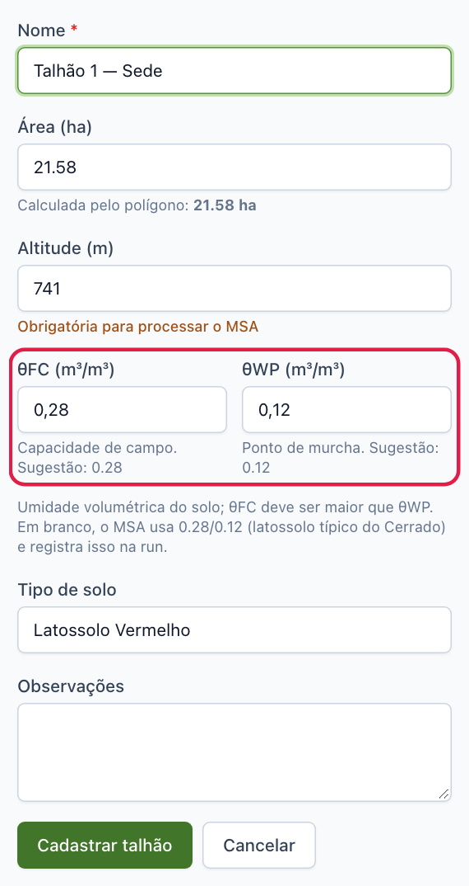

**Quando usar os valores padrão.** Se você não tem a análise física do solo, deixe os dois campos em branco. O sistema usa 0,28 e 0,12, valores típicos de latossolo do Cerrado, e registra no processamento que usou o padrão.

**Quando informar os seus.** Se o laudo físico do solo traz a curva de retenção de água, use os valores dele. Solos arenosos guardam menos água e têm números menores. Solos muito argilosos têm números maiores. Valores do próprio talhão deixam o resultado mais fiel.

Os campos **Tipo de solo** e **Observações** são livres e opcionais.

## Salvar e conferir

1. Clique em **Cadastrar talhão**.

2. O sistema abre a página do talhão, com o desenho em verde, um ponto marrom no centro e os dados informados.

   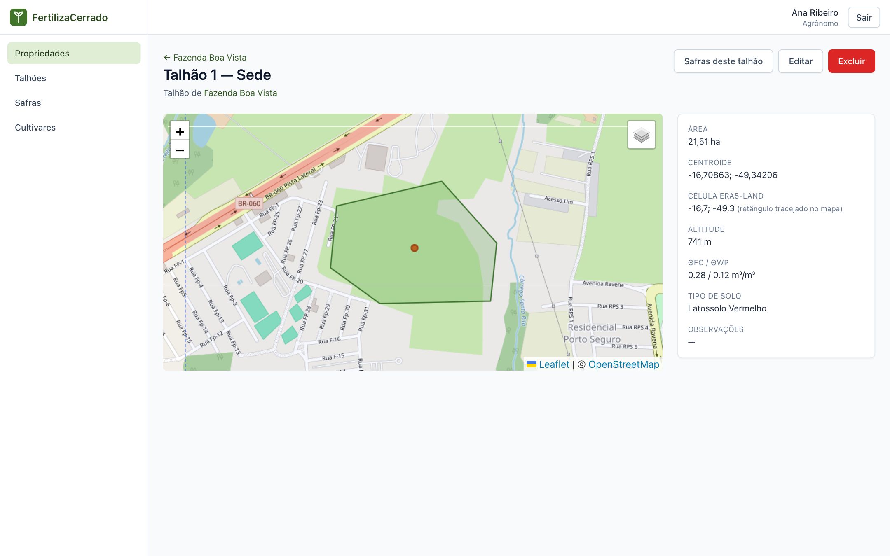

3. Confira o campo **Célula ERA5-Land**. Ele mostra de onde virão os dados de clima.

**O que é a célula.** Os dados de clima vêm do [ERA5-Land](08-perguntas-e-glossario.md#era5-land), que divide o território em quadrados de cerca de 9 km de lado. O sistema usa o quadrado onde cai o centro do talhão. Todos os talhões dentro do mesmo quadrado recebem os mesmos dados de clima.

No mapa, o quadrado aparece como uma linha azul tracejada. Ele é muito maior que o talhão. Afaste o mapa com o botão **−** para vê-lo inteiro.

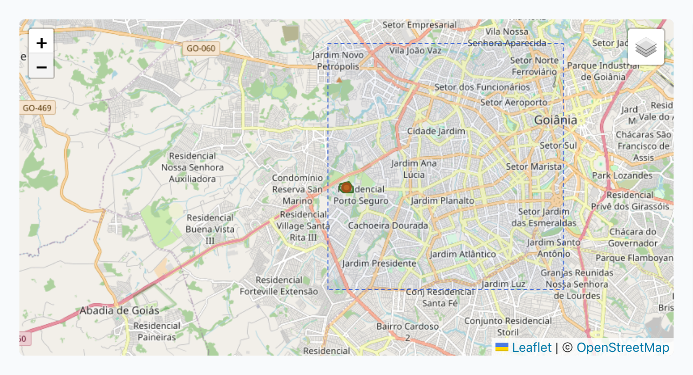

Nessa página, o botão **Safras deste talhão** leva às safras, **Editar** reabre o cadastro e **Excluir** apaga o talhão. Um talhão que já tem safra não pode ser excluído.

## Erros comuns de desenho

### Lados que se cruzam

Se você clicar nos cantos fora de ordem, os lados do polígono se cruzam e o desenho fica parecido com uma gravata. Ao salvar, o sistema recusa e mostra **Geometria inválida** sobre a parte de baixo do mapa. A mensagem traz o termo técnico *Self-intersection*, que quer dizer lados que se cruzam.

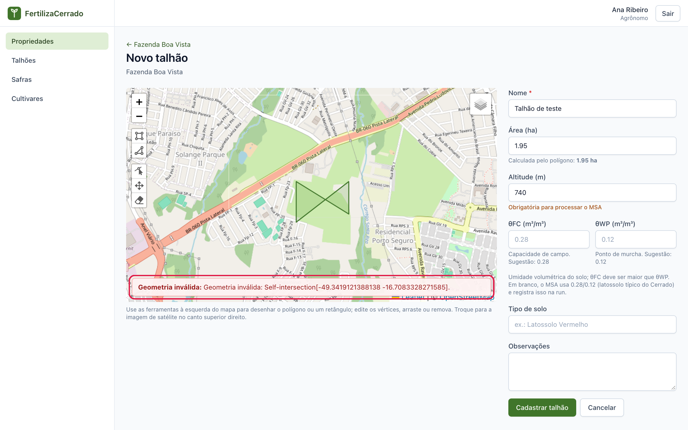

Para corrigir, use **editar** e desfaça o cruzamento arrastando os cantos, ou apague com a **borracha** e desenhe de novo, seguindo a divisa em um só sentido.

### Polígono não fechado

Enquanto você não clicar de novo no primeiro ponto, o talhão não existe. Se o campo **Área (ha)** continua vazio, o desenho não foi fechado. Ao tentar salvar, aparece **Desenhe o talhão no mapa.**

### Área muito pequena

Com o mapa muito afastado, um clique duplo vira um talhão minúsculo. O sistema exige pelo menos 0,01 ha. Aproxime o mapa e desenhe de novo.

### Talhão no lugar errado

Confira o município e as estradas antes de desenhar. Um talhão deslocado alguns quilômetros pode cair em outro quadrado de clima e receber dados de chuva de outro lugar.

### Altitude esquecida

O sistema deixa salvar o talhão sem altitude, mas avisa. Na lista de talhões aparece o selo **sem altitude — necessária para o MSA**. MSA é o módulo agrometeorológico, o painel do capítulo 6.

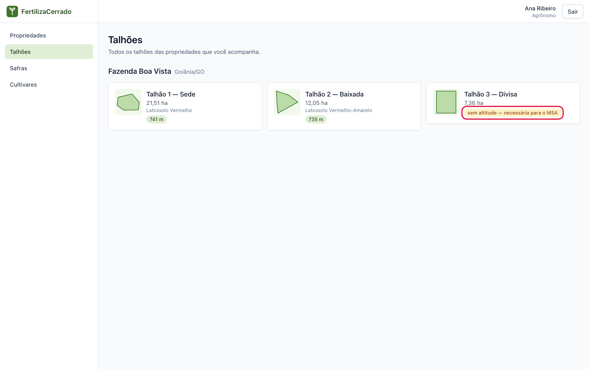

Na página do talhão, o aviso **Altitude não informada** traz o link **Informar altitude**, que leva direto à edição.

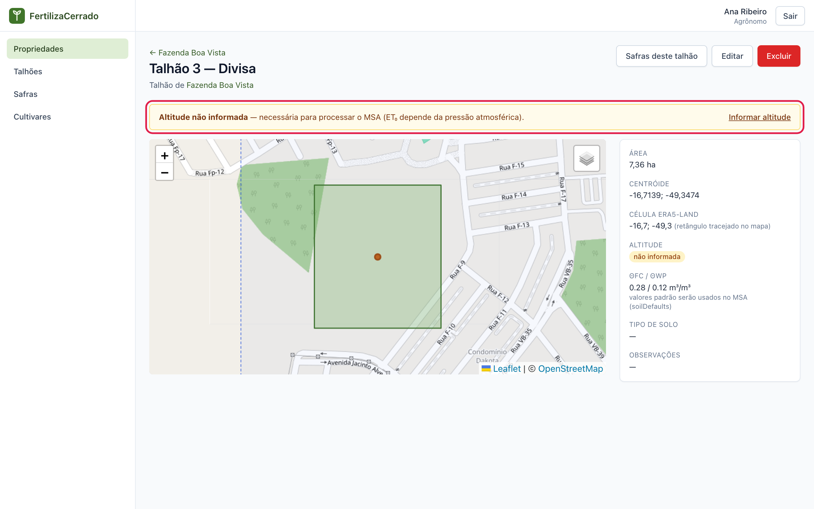

## Ver todos os talhões

No menu, clique em **Talhões**. A tela lista os talhões de todas as propriedades que você acompanha, agrupados por propriedade, com a área e a altitude de cada um.

---

Capítulo anterior: [Propriedades](02-propriedades.md) · Próximo: [Cultivares](04-cultivares.md)
