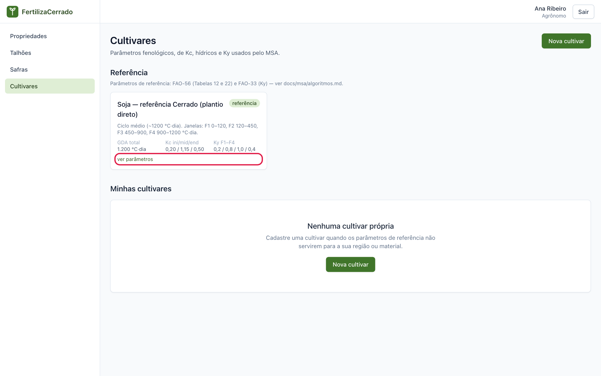
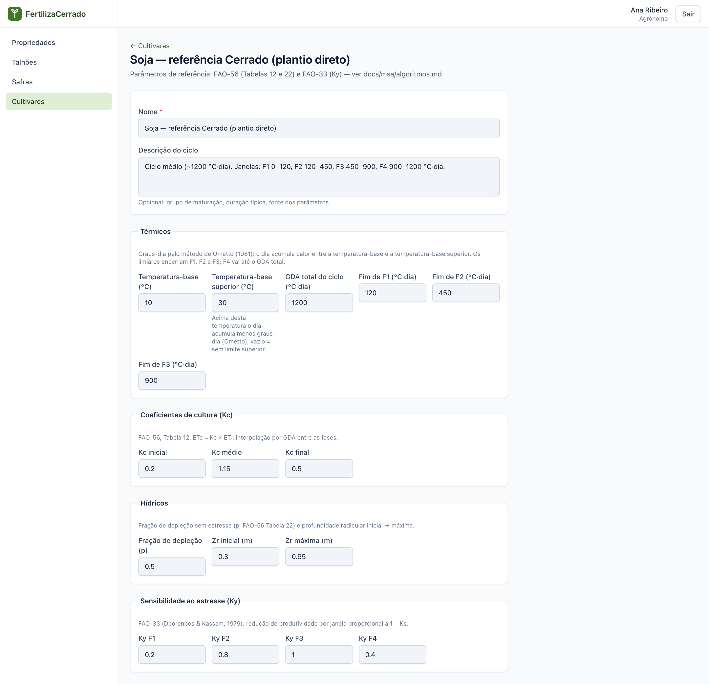
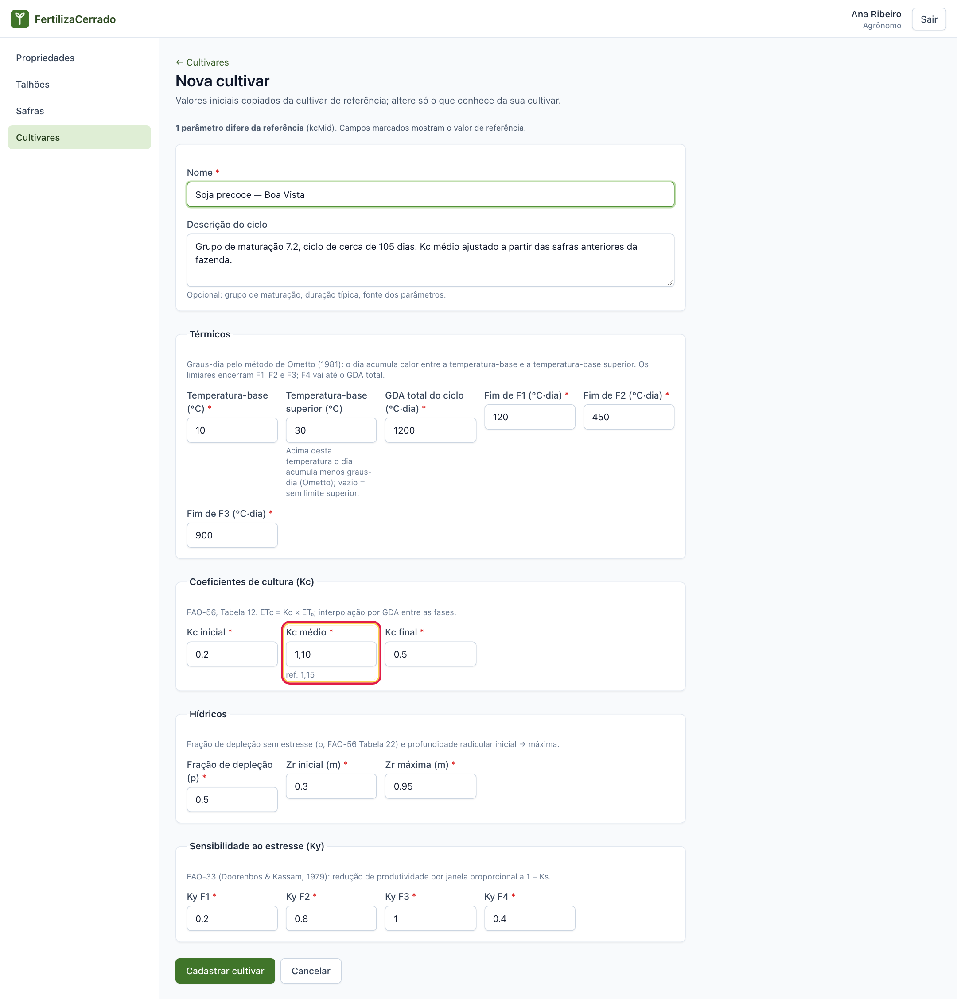
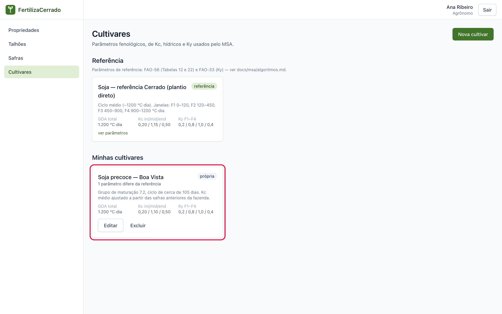
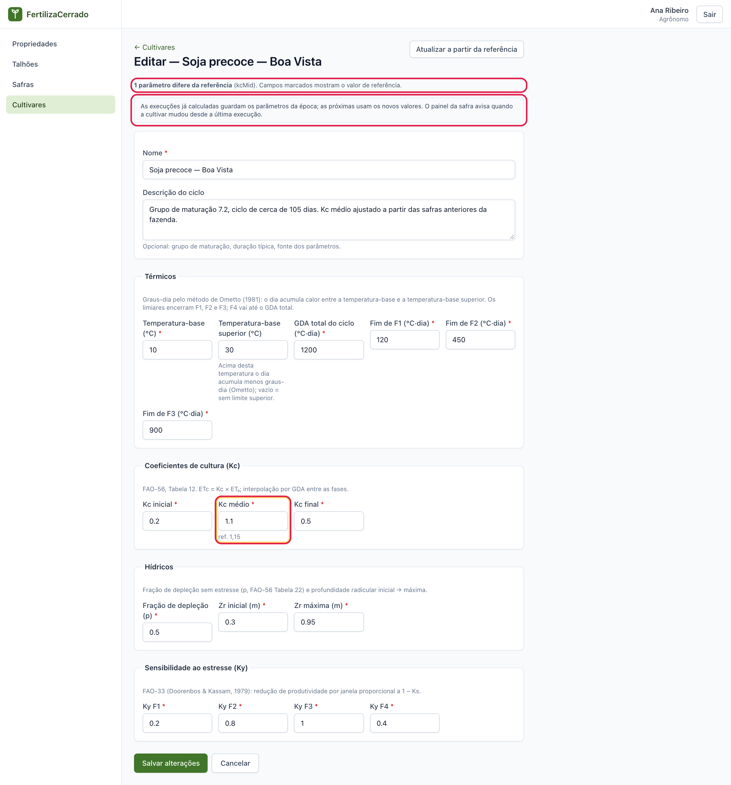
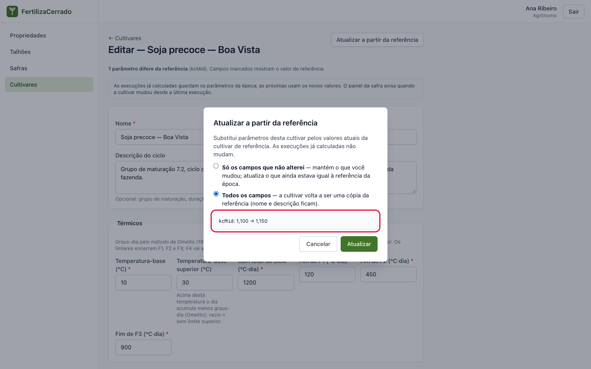

# Cultivares

**O que você vai fazer:** conhecer a cultivar de referência, cadastrar a sua a partir dela e entender o que cada número significa.
**Quem pode fazer:** agrônomo e administrador cadastram e editam. O produtor apenas consulta.

No sistema, a cultivar é o conjunto de números que descreve como a planta se desenvolve e quanta água ela usa. O painel agrometeorológico faz todas as contas a partir desses números. Nesta fase o sistema trabalha só com soja. Para a maioria das safras, a cultivar de referência resolve.

## A cultivar de referência

1. No menu, clique em **Cultivares**. A seção **Referência** traz a cultivar **Soja — referência Cerrado (plantio direto)**, já cadastrada.

   

2. Clique em **ver parâmetros** para abrir os números. Eles vêm das publicações da FAO usadas no mundo todo para manejo de água na agricultura e estão ajustados para plantio direto no Cerrado.

   

A cultivar de referência não pode ser alterada nem excluída. Ela vale para todos os usuários. Quando a equipe do sistema corrige um valor da referência, por exemplo depois de confirmar a temperatura-base superior com novos estudos, a mudança vale para todos, e você pode levá-la para as suas cultivares, como mostra a seção [Atualizar a partir da referência](#atualizar-a-partir-da-referência).

## O que significa cada grupo de parâmetros

### Térmicos

A planta não se desenvolve pelo calendário. Ela se desenvolve pelo calor que acumula. Um dia quente faz a planta avançar mais que um dia frio, mas só até certo ponto: acima de uma temperatura limite, o calor a mais não acelera a planta. O sistema mede esse avanço em [graus-dia acumulados](08-perguntas-e-glossario.md#gda-graus-dia-acumulados), o GDA, pelo método de Ometto, que considera as duas temperaturas-base da planta.

- **Temperatura-base:** abaixo dela a planta não se desenvolve. Para a soja, 10 °C.
- **Temperatura-base superior (°C):** acima dela o calor extra já não faz a planta avançar. Em um dia muito quente, com máxima de 34 °C, por exemplo, só o calor até a temperatura-base superior conta, e o dia acumula um pouco menos graus-dia do que acumularia sem esse limite. É isso que o sistema quer dizer com a ajuda do campo: "Acima desta temperatura o dia acumula menos graus-dia (Ometto)". Para a soja, a referência usa 30 °C, valor provisório que a equipe científica ainda vai confirmar. O campo é opcional: deixe vazio para não usar limite superior (o dia conta todo o calor acima da temperatura-base). Se informar, o valor precisa ser maior que a temperatura-base.
- **GDA total do ciclo:** o calor que a planta precisa acumular da emergência à maturação.
- **Fim de F1, F2 e F3:** o GDA em que termina cada janela do ciclo.

O ciclo é dividido em quatro janelas:

| Janela | Fase da lavoura |
|---|---|
| **F1** | Germinação e estabelecimento |
| **F2** | Crescimento vegetativo |
| **F3** | Floração e enchimento de grãos |
| **F4** | Maturação |

Uma cultivar precoce tem GDA total menor. Uma tardia tem GDA total maior.

### Coeficientes de cultura (Kc)

O [Kc](08-perguntas-e-glossario.md#kc-coeficiente-de-cultura) diz quanta água a lavoura usa em comparação com um gramado bem irrigado.

- **Kc inicial:** lavoura pequena, solo quase descoberto. No plantio direto a palhada protege o solo, e o valor é baixo.
- **Kc médio:** lavoura fechada, no auge do consumo de água.
- **Kc final:** lavoura secando para a colheita.

### Hídricos

- **Fração de depleção (p):** a parte da água do solo que a planta usa sem sofrer. Com 0,50, a planta fica confortável até gastar metade da água disponível. Depois disso começa o estresse.
- **Zr inicial e Zr máxima:** a profundidade das raízes, em metros, no começo e no auge do ciclo. Raiz mais funda alcança mais água.

### Sensibilidade ao estresse (Ky)

O Ky diz quanto a produtividade cai quando falta água em cada janela. Quanto maior o Ky, mais a falta de água pesa.

Na soja de referência, o Ky de F3 é 1,00 e o de F1 é 0,20. Falta de água na floração e no enchimento de grãos custa cinco vezes mais que a mesma falta na germinação.

## Cadastrar a sua cultivar

Cadastre uma cultivar própria quando o material que você planta tem ciclo bem diferente da referência, ou quando você tem dados locais melhores.

Ninguém precisa digitar os dezesseis números do zero. Uma cultivar nova nasce como cópia da referência: você altera só o que conhece da sua cultivar, e o sistema marca o que ficou diferente.

1. Na tela **Cultivares**, clique em **Nova cultivar**. O formulário abre com todos os parâmetros já preenchidos com os valores da referência. Logo abaixo do título aparece o aviso **Valores iniciais copiados da cultivar de referência; altere só o que conhece da sua cultivar.**

2. Em **Identificação**, informe o **Nome**. A **Descrição do ciclo** vem copiada da referência e é opcional. Use-a para anotar o grupo de maturação e de onde vieram os números.

3. Altere apenas os parâmetros que você conhece. Cada campo alterado ganha uma borda amarela e a indicação **ref.** com o valor da referência, para você comparar. A linha acima do formulário resume: **igual à referência** ou, por exemplo, **1 parâmetro difere da referência (kcMid)**. Vale também para a **Temperatura-base superior**, que vem preenchida com 30: se você apagar o valor, o campo mostra **ref. 30,0** e conta como diferente da referência.

   

   No exemplo, só o **Kc médio** foi alterado, de 1,15 para 1,10.

4. Clique em **Cadastrar cultivar**. Ela aparece na seção **Minhas cultivares**, com o selo **própria** e o resumo do que difere da referência.

   

O sistema confere a coerência dos números. Os limites de F1, F2 e F3 precisam estar em ordem crescente e abaixo do GDA total. A raiz máxima não pode ser menor que a inicial. A temperatura-base superior, quando informada, precisa ser maior que a temperatura-base. Se algo estiver errado, o campo fica marcado com a explicação.

> **Atenção.** Esses números mudam o resultado do painel. Altere apenas o que você consegue justificar com dados da cultivar ou da região.

## Editar e excluir

Na seção **Minhas cultivares**, cada cartão tem os botões **Editar** e **Excluir**. Uma cultivar com safra vinculada não pode ser excluída.

Na tela de edição, a marcação dos campos que diferem da referência é a mesma do cadastro: borda amarela, valor de referência ao lado e o resumo no alto da página.

### O que acontece com as safras que já usam a cultivar

Você pode alterar os parâmetros de uma cultivar mesmo que ela já esteja em uso em uma safra. A tela de edição lembra isso com a nota: **As execuções já calculadas guardam os parâmetros da época; as próximas usam os novos valores. O painel da safra avisa quando a cultivar mudou desde a última execução.**

Funciona assim:

- Cada execução do painel guarda uma cópia dos parâmetros usados naquele cálculo. O resultado antigo continua correspondendo aos números da época.
- A próxima execução, seja a semanal ou um **Reprocessar**, usa os valores novos.
- Enquanto o painel mostrar uma execução feita com os valores antigos, aparece o aviso **Os parâmetros da cultivar … mudaram desde esta execução**, com a sugestão de reprocessar. Veja o [capítulo 6](06-painel-agrometeorologico.md#o-cabeçalho).

Se você quer manter a cultivar antiga para comparação, cadastre uma nova, por exemplo com o ano no nome, e use-a nas próximas safras.

## Atualizar a partir da referência

De tempos em tempos a equipe do sistema corrige a cultivar de referência, por exemplo quando a temperatura-base superior (hoje 30 °C, provisória) é confirmada por novos estudos. As suas cultivares não mudam sozinhas. Para trazer a correção, use o botão **Atualizar a partir da referência**, na tela de edição.

1. Abra a cultivar em **Editar** e clique em **Atualizar a partir da referência**.

2. Escolha o que atualizar:

   - **Só os campos que não alterei:** mantém tudo o que você mudou e atualiza apenas os campos que ainda estavam iguais à referência da época do cadastro. É a escolha comum.
   - **Todos os campos:** a cultivar volta a ser uma cópia da referência. O nome e a descrição ficam.

3. Confira a prévia. Ela lista cada campo que vai mudar, com o valor atual e o novo, como `kcMid: 1,100 → 1,150`. Se não houver nada a mudar, a prévia diz **Nada a atualizar**.

   

4. Clique em **Atualizar**. A mensagem **Atualizados a partir da referência: kcMid.** confirma o que mudou. Para desistir, clique em **Cancelar**.

Como em qualquer alteração de parâmetros, as execuções já calculadas não mudam, e as próximas usam os valores novos.

---

Capítulo anterior: [Talhões](03-talhoes.md) · Próximo: [Safras](05-safras.md)
