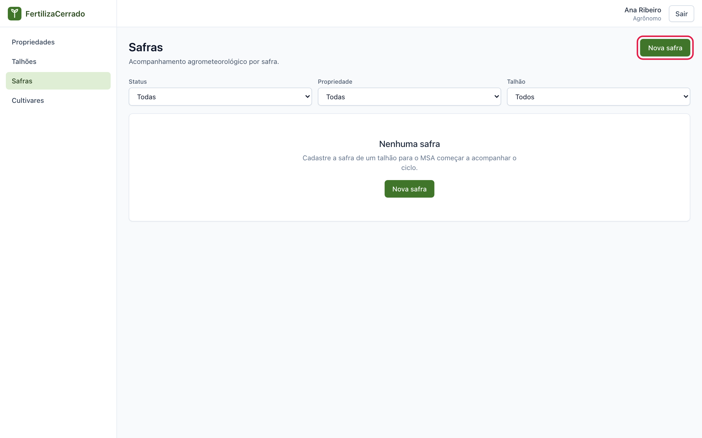
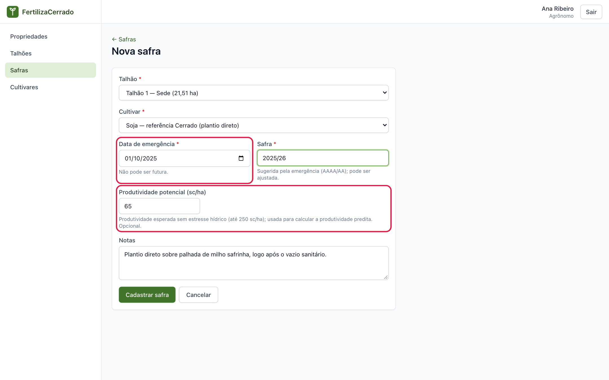
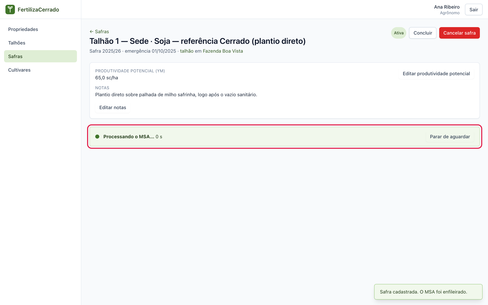
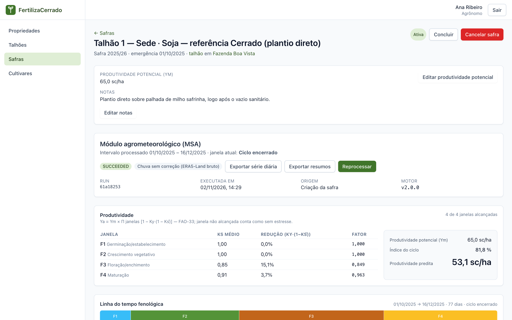
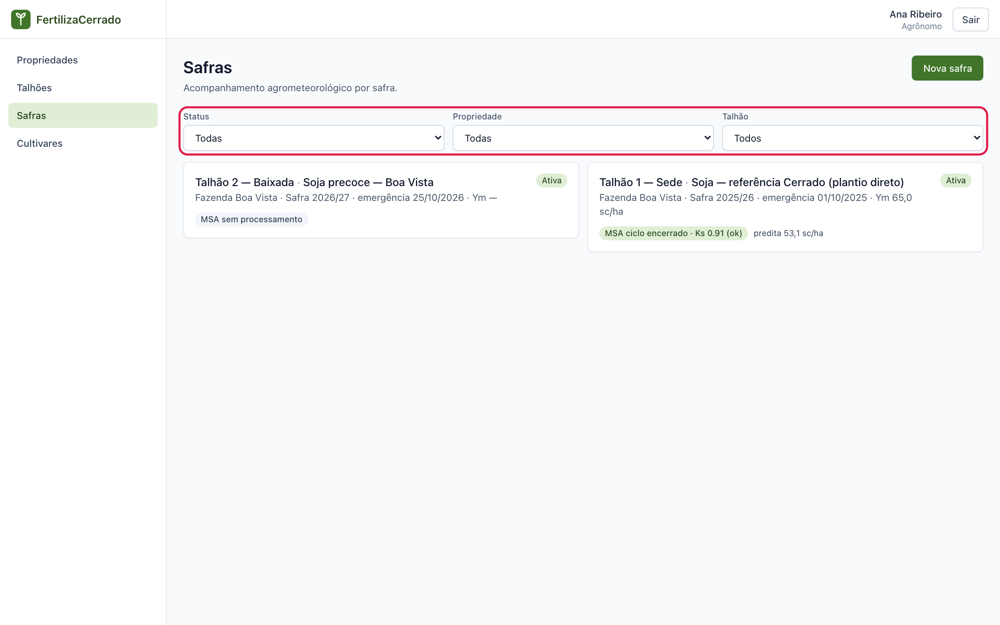
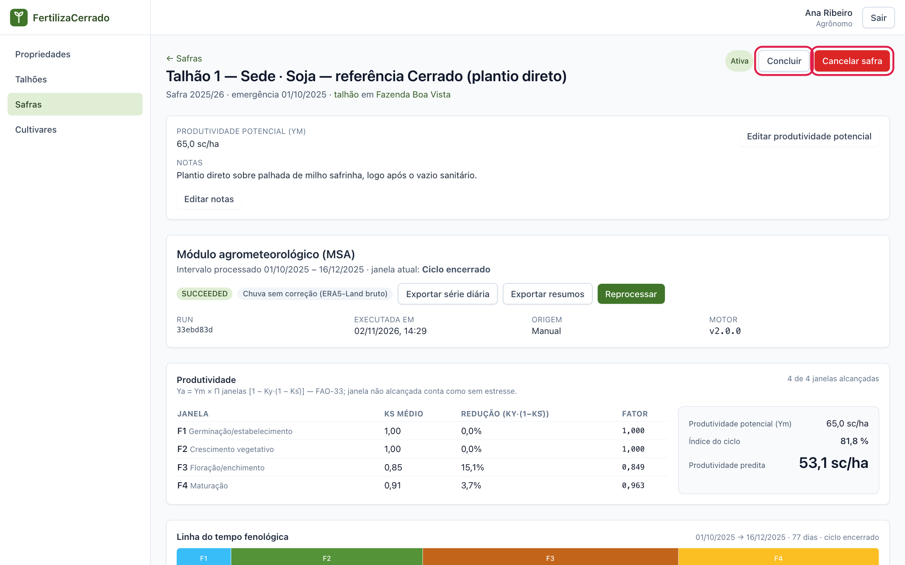
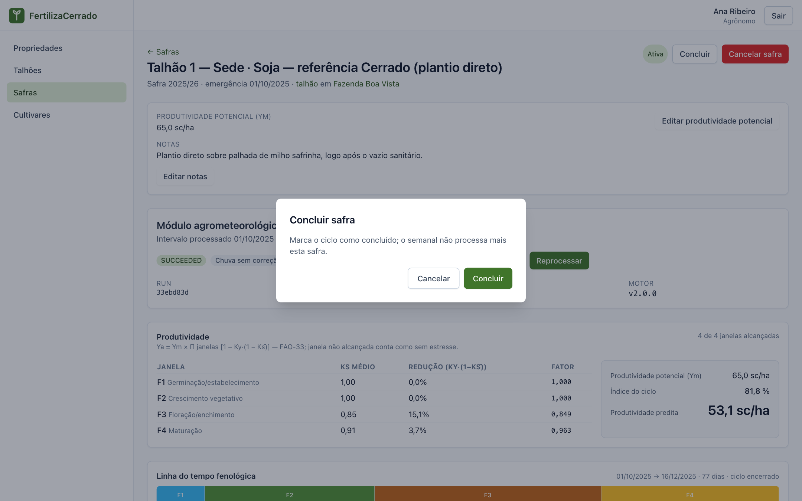
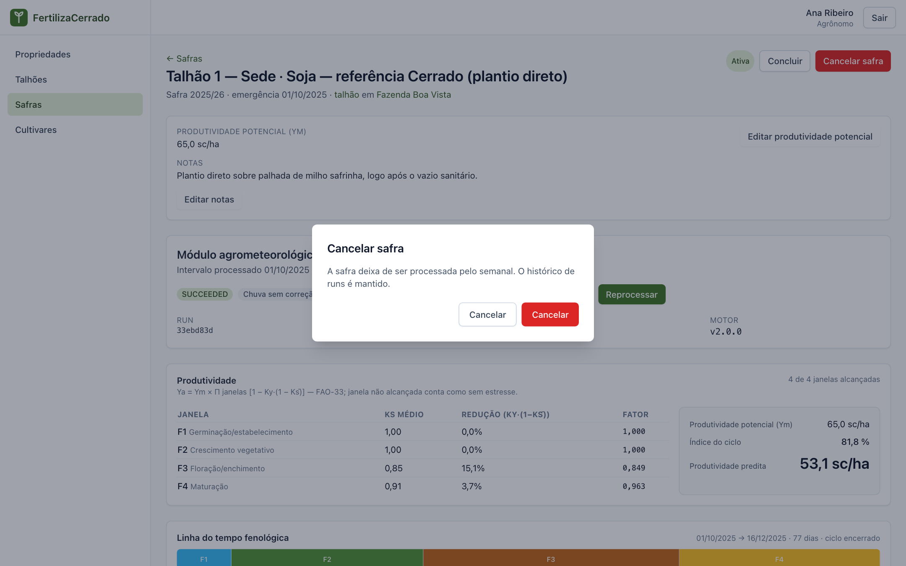
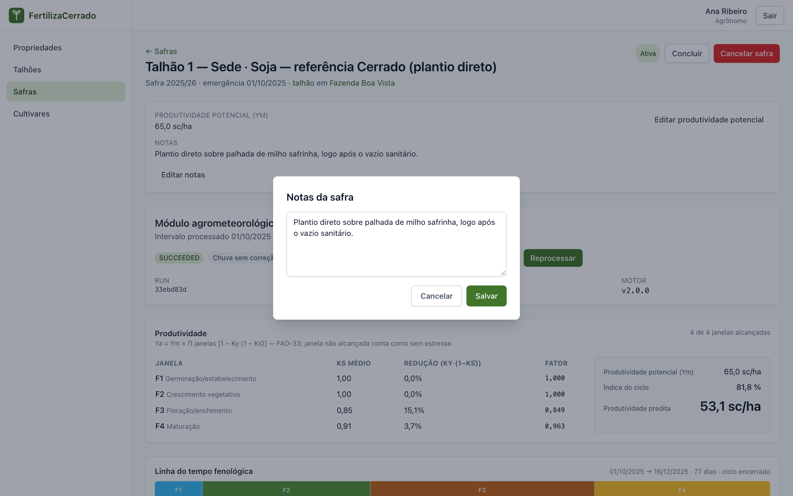
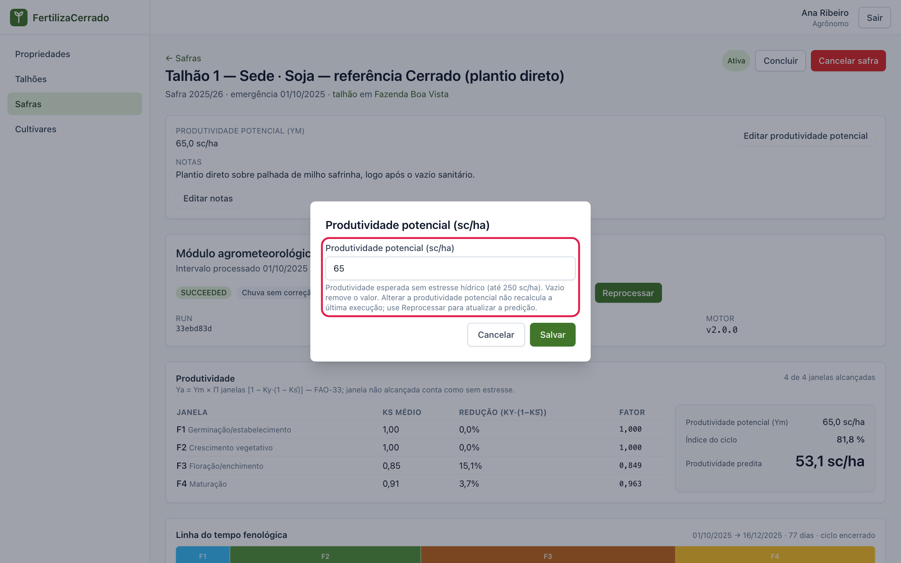

# Safras

**O que você vai fazer:** cadastrar a safra de um talhão, informar a produtividade potencial, acompanhar o processamento e encerrar a safra no fim do ciclo.
**Quem pode fazer:** agrônomo e administrador. O produtor apenas consulta.

A safra liga três coisas: um talhão, uma cultivar e a data em que a lavoura emergiu. Com isso o sistema monta o [painel agrometeorológico](06-painel-agrometeorologico.md). Se você informar também a produtividade potencial, o painel estima a produtividade da safra.

Antes de começar, confira se o talhão tem a altitude informada. Sem ela, a safra é cadastrada mas não é processada. Veja o [capítulo 3](03-talhoes.md#altitude).

## Cadastrar a safra

1. No menu, clique em **Safras**. Depois clique em **Nova safra**.

   

2. Em **Talhão**, escolha o talhão. A lista mostra a área de cada um e avisa quando falta a altitude.

3. Em **Cultivar**, escolha a cultivar de referência ou uma das suas.

4. Em **Data de emergência**, informe o dia em que as plântulas apareceram na superfície do solo.

5. O campo **Safra** é preenchido sozinho a partir da data, no formato ano/ano. Ajuste se precisar.

6. Em **Produtividade potencial (sc/ha)**, informe quantas sacas por hectare essa lavoura produziria se não faltasse água em nenhum momento. É opcional, mas sem ela o painel não calcula a produtividade predita. Veja [como escolher o valor](#sobre-a-produtividade-potencial). **Notas** é um campo livre.

   

7. Clique em **Cadastrar safra**.

### Sobre a data de emergência

Use a data da emergência, e não a do plantio. O sistema conta o desenvolvimento da planta a partir do dia em que ela nasce. Entre o plantio e a emergência costumam passar de cinco a dez dias, conforme a umidade e a temperatura do solo.

Se a emergência foi desigual, use o dia em que cerca de metade das plantas estava visível.

A data não pode ser futura. Ela também não pode ser corrigida depois. Se você errou, cancele a safra e cadastre outra.

Cada talhão aceita uma única safra ativa por vez. Para cadastrar a próxima, conclua ou cancele a anterior.

### Sobre a produtividade potencial

A [produtividade potencial](08-perguntas-e-glossario.md#produtividade-potencial-ym), chamada de **Ym** nas telas, é a produtividade que você espera dessa lavoura em um ano sem falta de água, com o manejo e a adubação planejados. Ela é o ponto de partida da estimativa: o painel calcula quanto a falta de água tira dela.

Para escolher o valor, use a média das melhores safras do talhão, o potencial informado pelo obtentor da cultivar ou a sua experiência na região. No exemplo deste manual, a safra foi cadastrada com 65 sc/ha. O sistema aceita até 250 sc/ha.

Se você não tem o número agora, deixe em branco e informe depois, pela página da safra. O painel mostra o quanto a produtividade foi afetada mesmo sem a Ym, mas só calcula a produtividade em sacas quando ela existe.

## Acompanhar o processamento

Ao cadastrar, o sistema abre a página da safra e começa a trabalhar sozinho. Aparece a faixa **Processando o MSA…**, com o tempo decorrido.

Nesse momento o sistema busca os dados de clima do talhão, da emergência até os dias mais recentes disponíveis, e faz os cálculos. Você não precisa ficar na tela. Pode sair e voltar depois.

O tempo varia:

- **alguns segundos**, quando os dados de clima daquela região já estão no sistema;
- **vários minutos**, na primeira safra de uma região nova, porque os dados precisam ser baixados.

O botão **Parar de aguardar** só fecha a faixa. O processamento continua.

Quando termina, a faixa dá lugar ao painel.

A leitura do painel está no [capítulo 6](06-painel-agrometeorologico.md). Se em vez do painel aparecer **Sem processamento do MSA**, veja [o que fazer](06-painel-agrometeorologico.md#quando-aparece-sem-processamento-do-msa).

### Atualização semanal

Enquanto a safra estiver ativa, o sistema a reprocessa toda segunda-feira, com os dados de clima da semana. Você não precisa fazer nada.

## Consultar as safras

No menu, clique em **Safras**. Cada cartão mostra o talhão, a cultivar, a propriedade, a safra, a data de emergência e a produtividade potencial (**Ym**). Um selo resume a situação do painel:

- a janela em que a lavoura está, ou **ciclo encerrado**;
- o [Ks](08-perguntas-e-glossario.md#ks-coeficiente-de-estresse-hídrico) da janela e a sua classificação;
- ao lado do selo, a produtividade **predita**, em sacas por hectare, ou, quando a safra não tem Ym, o **índice** do ciclo em porcentagem;
- **MSA sem processamento**, quando ainda não há resultado.

Os filtros **Status**, **Propriedade** e **Talhão** reduzem a lista.

Na imagem, a safra da direita terminou o ciclo. A da esquerda emergiu há poucos dias e ainda não tem dados de clima suficientes.

## Concluir, cancelar e reativar

Os botões ficam no alto da página da safra, ao lado do selo de situação.

### Concluir

Clique em **Concluir** depois da colheita. A safra passa a **Concluída** e deixa de ser reprocessada toda semana. O painel e o histórico continuam disponíveis para consulta.

### Cancelar

Clique em **Cancelar safra** quando o cadastro estava errado ou a lavoura foi perdida ou replantada. A safra passa a **Cancelada** e também deixa de ser reprocessada. O histórico é mantido.

Nas duas janelas de confirmação, o botão **Cancelar** apenas fecha a janela, sem alterar a safra.

### Reativar

Uma safra concluída ou cancelada mostra o botão **Reativar**. Ele devolve a safra à situação **Ativa**, desde que o talhão não tenha outra safra ativa.

## Anotar observações

Clique em **Editar notas** para registrar o que aconteceu na lavoura: replantio, granizo, ataque de pragas, data da colheita. Essas anotações ajudam a interpretar o painel mais tarde.

## Informar ou alterar a produtividade potencial

A página da safra mostra o campo **Produtividade potencial (Ym)**, logo abaixo do título. Quando a safra foi cadastrada sem o valor, aparece **não informada**.

1. Clique em **Editar produtividade potencial**.

2. Na janela **Produtividade potencial (sc/ha)**, digite o valor, ou apague o campo para remover o valor.

   

3. Clique em **Salvar**. Para desistir, clique em **Cancelar**.

> **Importante.** Alterar a produtividade potencial não refaz a conta do painel. A estimativa que está na tela foi calculada com o valor da época e continua assim até a próxima execução. Para ver a estimativa com o valor novo, clique em **Reprocessar** no painel. Enquanto isso, o painel mostra o aviso **A produtividade potencial da safra mudou**. Veja o [capítulo 6](06-painel-agrometeorologico.md#produtividade).

---

Capítulo anterior: [Cultivares](04-cultivares.md) · Próximo: [Painel agrometeorológico](06-painel-agrometeorologico.md)
