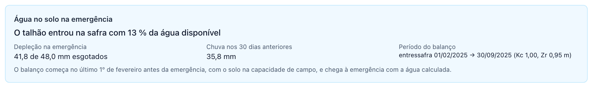
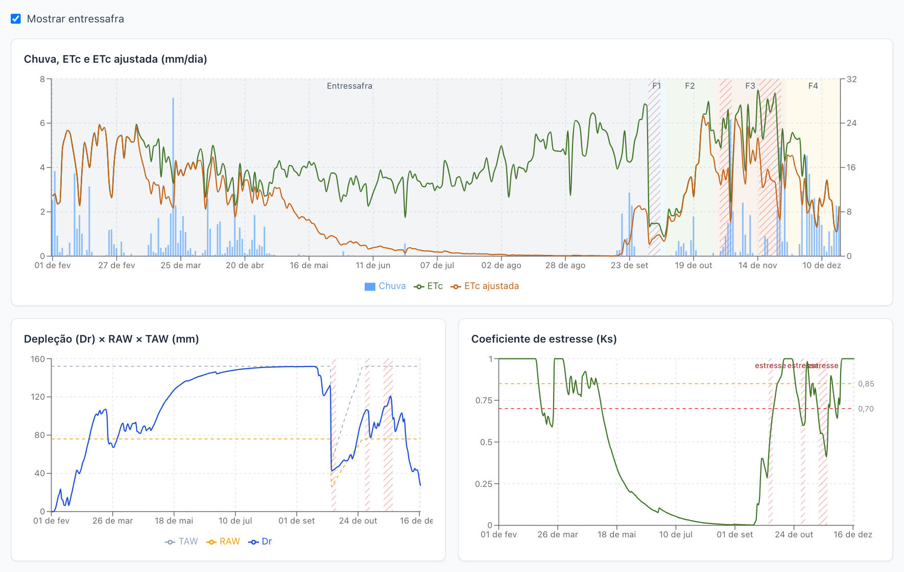
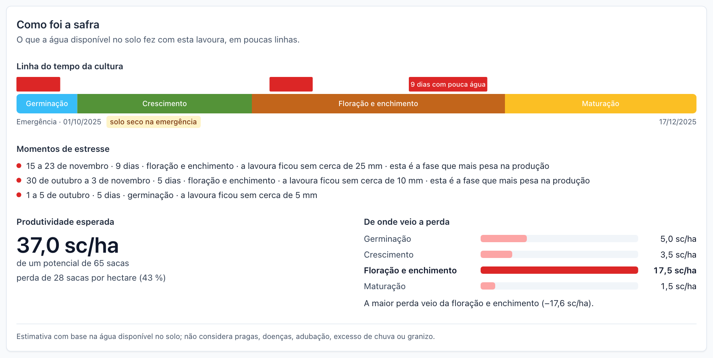
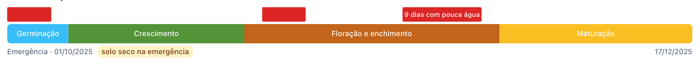
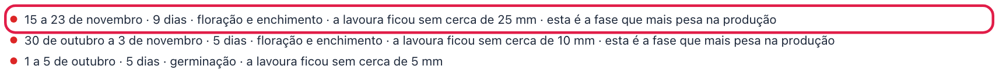
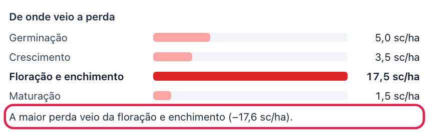

# Painel agrometeorológico

**O que você vai fazer:** ler o painel de uma safra, entender onde faltou água e quanto isso pode ter custado em produtividade.
**Quem pode fazer:** todos consultam. Agrônomo e administrador reprocessam e informam a produtividade potencial.

> **Importante.** O sistema apoia e não substitui a decisão do responsável técnico. O painel estima o efeito da falta de água a partir de dados de clima. Ele não enxerga a lavoura, a fertilidade do solo, as pragas nem o manejo. Use os números junto com o que você observa no campo.

O painel aparece na página de cada safra. Nas telas ele se chama **Módulo agrometeorológico (MSA)**. Para abri-lo, clique em **Safras** no menu e depois na safra.

## A ideia em uma página

A lavoura precisa de água todos os dias. A quantidade depende do clima e do tamanho da planta. O solo funciona como uma caixa-d'água: a chuva enche, a lavoura esvazia.

A conta começa antes da safra: desde o 1º de fevereiro anterior à emergência, com o solo cheio pelas chuvas de verão, o sistema acompanha a água do solo pela entressafra, para saber com quanta água o talhão entrou na safra (veja [Água no solo na emergência](#água-no-solo-na-emergência)). Depois, para cada dia da safra, o sistema faz esta conta:

1. Calcula quanta água a lavoura precisaria naquele dia.
2. Soma a chuva e desconta o consumo, para saber quanta água sobrou no solo.
3. Verifica se a água que sobrou foi suficiente. Se não foi, a lavoura sofreu.

O resultado de cada dia é um número chamado [Ks](08-perguntas-e-glossario.md#ks-coeficiente-de-estresse-hídrico), que vai de 0 a 1:

- **Ks = 1,00:** a lavoura teve toda a água de que precisava.
- **Ks = 0,70:** a lavoura conseguiu usar 70% da água de que precisava.

Quanto menor o Ks, maior a falta de água. O painel resume o Ks por fase do ciclo, estima quanto cada fase perdeu em produtividade e, com a produtividade potencial informada na safra, calcula a produtividade predita em sacas por hectare.

## O exemplo deste capítulo

As imagens mostram uma safra de soja da Fazenda Boa Vista, no Talhão 1 — Sede, com emergência em 01/10/2025 e produtividade potencial de 65 sc/ha. Foi um plantio antecipado, feito logo após o vazio sanitário. O ciclo durou 77 dias e terminou em 16/12/2025.

O painel completo fica assim. As próximas seções explicam cada parte. O bloco **Produtividade** fica logo abaixo do cabeçalho, mas é mais fácil de entender depois dos cartões das janelas, e por isso vem depois deles neste capítulo.

## O cabeçalho

O cabeçalho informa:

- **Intervalo processado:** de que dia até que dia há resultados. O último dia fica cerca de cinco dias antes de hoje, porque os dados de clima chegam com esse atraso.
- **Janela atual:** a fase em que a lavoura está. No exemplo, **Ciclo encerrado**.
- **Selo verde SUCCEEDED:** o processamento terminou bem.
- **Selo da chuva:** se a chuva foi corrigida ou não. Veja a próxima seção.
- **Executada em** e **Origem:** quando o cálculo foi feito e por quê. A origem pode ser **Criação da safra**, **Semanal** ou **Manual**.

Os campos **Run** e **Motor** identificam o cálculo. Eles servem para auditoria e para a equipe técnica reproduzir o resultado. No dia a dia você não precisa deles.

Quando os parâmetros da cultivar foram alterados depois do cálculo, o cabeçalho mostra o aviso **Os parâmetros da cultivar … mudaram desde esta execução; a run usa o snapshot da época.** Os números na tela continuam válidos para os parâmetros antigos. Para usar os novos, clique em **Reprocessar**. Veja o [capítulo 4](04-cultivares.md#o-que-acontece-com-as-safras-que-já-usam-a-cultivar).

### O selo de correção da chuva

A chuva é o dado mais incerto do painel. O selo diz qual chuva foi usada:

- **Chuva sem correção (ERA5-Land bruto):** o sistema usou a chuva estimada pelo [ERA5-Land](08-perguntas-e-glossario.md#era5-land), sem ajuste. É o caso do exemplo. Acontece quando não há estação meteorológica próxima cadastrada.
- **Chuva corrigida — estação…:** a chuva foi ajustada com as medições de uma estação. O selo traz o nome e o código da estação, os anos de dados usados e a distância até ela.

Com a chuva sem correção, dê mais atenção à comparação com o que choveu de fato na fazenda. Se você tem pluviômetro, compare os totais do período com o campo **Chuva acumulada** dos cartões. A [correção da chuva](08-perguntas-e-glossario.md#correção-da-chuva) é configurada pelo administrador, como mostra o [capítulo 7](07-administracao.md#estações-e-calibração-da-chuva).

## A linha do tempo F1–F4

A barra colorida mostra o ciclo dividido em quatro janelas:

| Janela | Fase da lavoura | No exemplo |
|---|---|---|
| **F1** | Germinação e estabelecimento | 01/10 a 06/10, 6 dias |
| **F2** | Crescimento vegetativo | 07/10 a 27/10, 21 dias |
| **F3** | Floração e enchimento de grãos | 28/10 a 24/11, 28 dias |
| **F4** | Maturação | 25/11 a 16/12, 22 dias |

A largura de cada faixa é proporcional à duração. As datas não são fixas: o sistema as calcula pelo calor acumulado desde a emergência, os [graus-dia](08-perguntas-e-glossario.md#gda-graus-dia-acumulados). Em um ano mais quente as janelas ficam mais curtas, mas o calor acima da [temperatura-base superior](08-perguntas-e-glossario.md#temperatura-base-superior-tb) da cultivar (30 °C na soja de referência) não conta: dias muito quentes acumulam um pouco menos graus-dia do que a temperatura média sugere.

Em uma safra em andamento, um traço vertical marca o dia de hoje. As janelas que ainda não chegaram aparecem em cinza, com a indicação **não alcançada**.

Passe o mouse sobre uma faixa para ver as datas.

## Os cartões das janelas

Cada janela tem um cartão com o resumo do que aconteceu nela.

### As cores

A cor do cartão vem da **redução potencial de produtividade** da janela — quanto da safra a falta de água naquela fase pode ter custado:

| Cor | Selo | Redução estimada | Leitura |
|---|---|---|---|
| Verde | **ok** | abaixo de 5% | Perda pequena ou nenhuma |
| Amarelo | **atenção** | de 5% a 15% | Perda moderada |
| Vermelho | **crítico** | acima de 15% | Perda grande |
| Cinza | **não alcançada** | — | A lavoura ainda não chegou a essa janela |

Repare que a cor não vem do Ks sozinho. A mesma falta de água pesa pouco na germinação e muito na floração, e é isso que a cor mostra.

No exemplo, um cartão está vermelho, dois amarelos e um verde: F1 com redução de 7,9<!-- valor:phases.F1.yieldReductionPct|1 -->% (**atenção** — o Ks ficou baixo, 0,60, porque o talhão entrou na safra com pouca água no solo, veja o cartão [Água no solo na emergência](#água-no-solo-na-emergência); mas a germinação pesa pouco na produção), F2 com 5,9<!-- valor:phases.F2.yieldReductionPct|1 -->% (**atenção**), F3 com 31,2% (**crítico**, um veranico na floração) e F4 com 4,2% (**ok**, Ks 0,89<!-- valor:phases.F4.ksMean|2 -->).

### Como ler um cartão

O cartão de F3, floração e enchimento, mostra:

- **Ks médio: 0,69<!-- valor:phases.F3.ksMean|2 -->.** Na média dos 29<!-- valor:phases.F3.days|0 --> dias da janela, a lavoura usou 69% da água de que precisava.

- **Redução potencial de produtividade: 31,2<!-- valor:phases.F3.yieldReductionPct|1 -->%.** É a estimativa de quanto da produtividade pode ter sido perdida nessa janela só pela falta de água. Ela combina o Ks médio com a sensibilidade da janela, o [Ky](08-perguntas-e-glossario.md#ky-sensibilidade-ao-estresse). Como passa de 15%, o cartão está em **crítico**.

- **ETc ajustada acumulada: 113,4<!-- valor:phases.F3.etcAdjAccum|1 --> mm.** A água que a lavoura realmente usou na janela.

- **Chuva acumulada: 124,4<!-- valor:phases.F3.precipAccum|1 --> mm.** O total de chuva da janela. Compare com o seu pluviômetro.

- **Dias na janela:** a duração da janela.

Os termos estão no glossário: [redução potencial de produtividade](08-perguntas-e-glossario.md#redução-potencial-de-produtividade) e [evapotranspiração da cultura](08-perguntas-e-glossario.md#evapotranspiração-da-cultura).

### Por que a mesma falta de água pesa diferente

Compare F1 e F3 no exemplo. O Ks médio é parecido (0,60 e 0,69), mas a redução estimada em F1 é de 7,9%, e em F3 chega a 31,2%: por isso F1 está em atenção e F3 em crítico. Já F4, com Ks 0,89, perde só 4,2<!-- valor:phases.F4.yieldReductionPct|1 -->%.

A diferença está na sensibilidade da planta. Na floração e no enchimento de grãos a soja é muito mais sensível à falta de água que na maturação. O sistema leva isso em conta por meio do [Ky](08-perguntas-e-glossario.md#ky-sensibilidade-ao-estresse) de cada janela.

Por isso, ao ler o painel, olhe primeiro para F3.

## Produtividade

Esta é a parte do painel que junta as quatro janelas em um único número: quanto a safra deve render, em sacas por hectare, considerando só a falta de água. O bloco **Produtividade** fica logo abaixo do cabeçalho.

> O sistema apoia e não substitui a decisão do responsável técnico. A produtividade predita é uma estimativa do efeito da água, e não uma previsão de colheita. O que fazer com ela, na adubação ou em qualquer outra decisão, é do responsável técnico.

### A tabela Redução por janela

A tabela da esquerda repete, para cada janela, o **Ks médio** e a **Redução** que você viu nos cartões, e acrescenta o **Fator**. O fator é o que sobra da produtividade depois da redução: 1 menos a redução. Uma janela sem falta de água tem fator 1,000. Uma janela que ainda não chegou aparece como **não alcançada — fator 1**.

No exemplo:

| Janela | Ks médio | Redução | Fator |
|---|---|---|---|
| F1 | 0,60 | 7,9% | 0,921 |
| F2 | 0,93 | 5,9% | 0,941 |
| F3 | 0,69 | 31,2% | 0,688 |
| F4 | 0,89 | 4,2% | 0,958 |

### Os três números da direita

- **Produtividade potencial (Ym): 65,0<!-- valor:yield.ym|1 --> sc/ha.** É o valor informado no cadastro da safra: quanto a lavoura renderia sem falta de água. Veja o [capítulo 5](05-safras.md#sobre-a-produtividade-potencial).

- **Índice do ciclo: 57,1 %<!-- valor:yield.yieldIndexPct|1 -->.** É o produto dos quatro fatores: 0,921 × 0,941 × 0,688 × 0,958 = 0,571. A leitura é direta: a estimativa é que a safra renda 57,1% da produtividade potencial. A falta de água na floração responde pela maior parte da perda.

- **Produtividade predita: 37,1<!-- valor:yield.predicted|1 --> sc/ha.** É a produtividade potencial multiplicada pelo índice: 65 × 0,571 = 37,1 sc/ha. A diferença para a Ym, cerca de 28 sacas, é a estimativa do que a falta de água custou nessa safra.

A linha **4 de 4 janelas alcançadas**, no alto do bloco, diz quantas janelas já entraram na conta com dados reais. A fórmula está escrita abaixo do título do bloco, para quem quiser conferir; a explicação completa está em [`docs/msa/algoritmos.md`](../msa/algoritmos.md), seção 6.

### Quando a safra ainda não terminou

Enquanto a lavoura não chega ao fim do ciclo, o bloco mostra o aviso **Predição parcial: considera o restante do ciclo sem estresse.** As janelas que ainda não chegaram entram com fator 1, como se não fosse faltar água nelas. A cada processamento semanal o número é atualizado com as janelas alcançadas. Em uma safra em F2, por exemplo, a produtividade predita ainda não sabe nada sobre a floração, que é a fase mais sensível.

### Quando a safra não tem produtividade potencial

Sem a Ym, o bloco mostra **não informada** no lugar do valor, calcula o índice do ciclo mesmo assim e deixa a produtividade predita em branco. O agrônomo vê o link **Informar a produtividade potencial**, que abre a janela de edição da safra. O produtor vê o texto **Produtividade potencial não informada pelo responsável técnico.**

### Quando a produtividade potencial mudou

Se a Ym da safra foi alterada depois do cálculo, o bloco mostra o aviso **A produtividade potencial da safra mudou … reprocesse para atualizar a predição.** Os números na tela foram calculados com o valor antigo, e o bloco mostra esse valor antigo em **Produtividade potencial (Ym)**. Clique em **Reprocessar** para refazer a conta com o valor novo.

### Água no solo na emergência

Na parte de baixo do bloco Produtividade fica o cartão **Água no solo na emergência**. Ele responde a uma pergunta simples: quando a lavoura nasceu, o solo estava cheio ou já vinha seco?

O sistema não adivinha esse valor. Ele faz a conta da água no solo desde o 1º de fevereiro anterior à emergência, quando o solo costuma estar cheio pelas chuvas de verão, e acompanha a entressafra dia a dia, sem lavoura: o sol e o vento secam, a chuva repõe. O que o cartão mostra é o resultado dessa conta no dia da emergência. O [capítulo 5](05-safras.md#por-que-a-safra-começa-em-fevereiro) explica por que a safra "começa" em fevereiro.

- **O talhão entrou na safra com N % da água disponível.** É a frase principal. 100% significa solo cheio, na capacidade de campo. Quanto menor a porcentagem, mais seco o solo estava quando a plântula nasceu, e mais depressa a lavoura pode sentir falta de água nas primeiras semanas, se a chuva falhar.
- **Depleção na emergência: X de Y mm esgotados.** O mesmo número em milímetros. Y é toda a água que a camada explorada pelas raízes novas (30 cm na soja de referência) guardaria se estivesse cheia; X é quanto dela faltava no dia da emergência. Veja [Depleção](08-perguntas-e-glossario.md#depleção-dr).
- **Chuva nos 30 dias anteriores: Z mm.** A chuva do mês que antecedeu a emergência. Ajuda a entender a porcentagem: pouca chuva em setembro e outubro costuma significar solo seco na emergência.
- **Período do balanço: entressafra 01/02/2025 → 31/10/2025 (Kc 1,00, Zr 0,95 m).** De que dia a que dia a conta da entressafra foi feita e com que parâmetros. **Kc** é o coeficiente usado para a evaporação do solo sem lavoura e **Zr** a profundidade de solo considerada. São valores padrão do sistema, iguais para todos os talhões.

Abaixo vem a frase **O balanço começa no último 1º de fevereiro antes da emergência, com o solo na capacidade de campo, e chega à emergência com a água calculada.**, que resume o método.

Se o cartão disser **Esta execução não tem entressafra (motor anterior); reprocesse para calcular a água na emergência.**, a execução que está na tela foi feita por uma versão anterior do sistema, que começava a conta na emergência com o solo cheio. Clique em **Reprocessar** (agrônomo e administrador) para refazer a conta com a entressafra. O produtor vê o aviso, mas não o botão.

> O número do cartão vale para a água, apenas. Ele não enxerga a palhada, a compactação nem o preparo do solo, e usa os mesmos parâmetros de entressafra em todos os talhões. Use-o junto com o que você viu no campo no plantio.

## Os três gráficos

Nos três gráficos, os **momentos de estresse** (veja [Como foi a safra](#como-foi-a-safra)) aparecem como faixas verticais hachuradas em vermelho; no gráfico de Ks elas vêm com o rótulo "estresse".

Os gráficos mostram o dia a dia. Eles respondem quando faltou água e por quê.

### Chuva, ETc e ETc ajustada

- **Barras azuis:** a chuva de cada dia. A escala fica à direita.
- **Linha verde, ETc:** a água de que a lavoura precisava. A escala fica à esquerda.
- **Linha laranja, ETc ajustada:** a água que a lavoura conseguiu usar.

Quando as duas linhas andam juntas, não faltou água. **Quando a laranja fica abaixo da verde, houve estresse.** O espaço entre elas é a água que faltou.

No exemplo, as linhas se separam em novembro. As chuvas daquele período foram poucas e espaçadas, bem na floração.

As faixas coloridas ao fundo marcam as janelas F1 a F4.

### Depleção, RAW e TAW

Este gráfico mostra a caixa-d'água do solo.

- **Linha azul, Dr:** quanta água já foi gasta. Zero é o solo cheio. Quanto mais alta a linha, mais seco o solo.
- **Linha laranja tracejada, RAW:** o limite de conforto. Abaixo dela a planta tira água do solo sem dificuldade.
- **Linha cinza tracejada, TAW:** o fundo da caixa. É toda a água que o solo guarda para a planta.

**Quando a linha azul cruza a laranja, começa o estresse.** Quanto mais perto ela chega da cinza, mais severa a falta de água. Depois de uma chuva boa, a linha azul cai.

As duas linhas tracejadas sobem no início do ciclo porque a raiz está crescendo e alcançando mais solo. Veja [TAW e RAW](08-perguntas-e-glossario.md#taw-e-raw) no glossário.

### Coeficiente de estresse (Ks)

É o resultado final, dia a dia. A linha fica em 1 enquanto há água suficiente e cai quando falta. As linhas tracejadas em 0,85 e 0,70 são os mesmos limites das cores dos cartões.

No exemplo, o Ks cai abaixo de 0,70 por alguns dias em novembro e se recupera com as chuvas seguintes. O Ks médio do cartão de F3 é a média de todos os dias da janela, e por isso fica acima do ponto mais baixo.

### Ver os números de um dia

Passe o mouse sobre qualquer gráfico. Aparece um quadro com todos os valores daquele dia: a janela, a chuva, a ETc, o Ks e os demais.

### Ver a entressafra nos gráficos

Por padrão os três gráficos começam na emergência. Para ver também os meses anteriores, marque a caixa **Mostrar entressafra**, logo acima dos gráficos.

Com a caixa marcada:

- os gráficos passam a começar no 1º de fevereiro anterior à emergência, e os dias sem lavoura ficam sob uma **faixa cinza** chamada **Entressafra**. No gráfico de depleção dá para ver o solo secando ao longo da estação seca e, se choveu antes do plantio, enchendo de novo;
- ao passar o mouse sobre um dia da entressafra, o quadro mostra a fase **Entressafra**, graus-dia zero e o Kc e a profundidade usados na entressafra;
- a **linha do tempo F1–F4** não muda: ela continua começando na emergência, porque as janelas são da lavoura;
- **Exportar série diária** passa a incluir os dias da entressafra, com a coluna Fase igual a `PRE`.

Desmarque a caixa para voltar ao padrão. A caixa fica desabilitada quando a execução na tela foi feita por uma versão anterior do sistema, sem entressafra.

## Como foi a safra

No fim do painel há um resumo escrito para quem não quer coeficientes: a **linha do tempo da cultura**, os **momentos de estresse**, a **produtividade esperada** e **de onde veio a perda**. Ele é igual para o agrônomo, o administrador e o produtor, e reúne em poucas linhas o que os cartões e os gráficos mostram em detalhe. No cabeçalho do painel, o link **Ir para o resumo da safra** leva direto a ele.

> O sistema apoia e não substitui a decisão do responsável técnico. Os números desta seção são os mesmos do bloco Produtividade, apenas escritos de outro jeito.

### A linha do tempo da cultura

A barra mostra as quatro fases com os nomes do campo — **Germinação**, **Crescimento**, **Floração e enchimento** e **Maturação** —, com a largura proporcional aos dias de cada uma e as datas de emergência e fim. Sobre a barra, cada **momento de estresse** aparece como um segmento vermelho com a duração ("12 dias com pouca água"). Quando a safra ainda está em andamento, um traço marca **hoje**. Se o talhão entrou na safra com menos de 30% da água disponível, o início da barra traz a etiqueta **solo seco na emergência** — é o caso do exemplo.

Passe o mouse sobre um segmento vermelho para ler o período, a fase e a água que faltou.

### Os momentos de estresse

Um **momento de estresse** é um período de pelo menos três dias seguidos em que o Ks ficou abaixo de 0,70 — a lavoura usou menos de 70% da água de que precisava. A lista traz os momentos do mais danoso ao menos danoso, cada um em uma linha: o período, a duração, a fase em que aconteceu e **quanta água a lavoura ficou sem**, em milímetros (a soma, dia a dia, da água que a lavoura deixou de usar). Quando o momento cai na floração e enchimento, a linha avisa: **esta é a fase que mais pesa na produção**.

No exemplo, o momento mais danoso é o da floração. Um período de estresse que começa numa fase e termina na seguinte não é dividido: ele aparece inteiro, com a fase em que passou mais dias. Quando não houve nenhum período relevante, a seção diz **Nenhum período de falta de água relevante até agora**.

### Produtividade esperada e de onde veio a perda

À esquerda, a **produtividade esperada** em sacas por hectare, com a potencial logo abaixo ("de um potencial de 65 sacas"), e a **perda** em sacas e em porcentagem: no exemplo, 27,9<!-- valor:story.totalLossScHa|1 --> sacas por hectare, que a tela arredonda para 28. A produtividade esperada é o mesmo número da produtividade predita do bloco Produtividade, arredondado a meia saca. Se a safra ainda não terminou, uma frase lembra que o número considera o restante do ciclo sem falta de água.

À direita, **De onde veio a perda** divide essas sacas entre as quatro fases, em barras. A conta é feita na ordem do ciclo: a perda de cada fase é calculada sobre o que ainda restava depois das anteriores, e as quatro barras somadas dão exatamente a perda total. A barra maior fica em destaque e a frase abaixo resume: **A maior perda veio da floração e enchimento**.

Quando a safra não tem produtividade potencial, a seção mostra as perdas só em porcentagem e convida o agrônomo a informar a Ym.

No rodapé, uma frase fixa lembra o que esse número é e o que não é: **estimativa com base na água disponível no solo; não considera pragas, doenças, adubação, excesso de chuva ou granizo**. Se a execução na tela foi feita por uma versão anterior do sistema, a seção pede para reprocessar; se os números foram calculados na hora a partir da execução antiga, ela avisa.

## Exportar em CSV

Os três botões do cabeçalho baixam arquivos que abrem no Excel e em outras planilhas.

- **Exportar série diária** baixa uma linha por dia, com a janela, os graus-dia, a profundidade da raiz, a ET₀, o Kc, a ETc, a chuva, a depleção, o Ks, a ETc ajustada, o TAW e o RAW. O arquivo traz o que está nos gráficos: por padrão, só os dias da lavoura, da emergência em diante; com **Mostrar entressafra** marcado, também os dias da entressafra, com a coluna Fase igual a `PRE`.
- **Exportar resumos** baixa uma linha por janela, com os dias, o Ks médio, a redução, a ETc ajustada e a chuva acumuladas, o índice do ciclo, a produtividade potencial e a produtividade predita, repetidos em todas as linhas, e a **perda em sacas** atribuída à janela. A perda e as colunas de Ym e predita ficam vazias quando a safra não tem Ym.
- **Exportar estresses** baixa uma linha por momento de estresse: início, fim, dias, fase dominante, fases atravessadas, Ks mínimo e médio e a água que faltou.

O arquivo vai para a pasta de downloads do computador. O nome traz o talhão e a safra, por exemplo `serie-diaria-talhao-1-sede-2025-26-b652aedf.csv`, em que o trecho final identifica a execução. As colunas são separadas por ponto e vírgula e os números usam vírgula decimal, no padrão brasileiro.

Use a exportação para montar relatórios, comparar com os dados do pluviômetro ou guardar uma cópia fora do sistema.

## Histórico de execuções e reprocessamento

Toda vez que o painel é recalculado, o sistema guarda a execução anterior. A tabela **Histórico de runs**, no fim da página, lista todas.

A coluna **Origem** diz o que provocou cada execução: **Criação da safra**, **Semanal** ou **Manual**. A coluna **Índice · predita** traz o índice do ciclo e a produtividade predita de cada execução, o que permite acompanhar como a estimativa evoluiu ao longo da safra. A linha marcada como **exibida** é a que está na tela.

Clique em **Ver série** para carregar os gráficos e o bloco Produtividade de uma execução antiga. Um aviso aparece acima dos gráficos, com o botão **Voltar à run mais recente**. Isso serve para ver como o painel estava em uma data anterior.

### Reprocessar

Clique em **Reprocessar** para recalcular o painel agora. Faça isso quando:

- você corrigiu a altitude ou os dados de solo do talhão;
- você informou ou alterou a produtividade potencial da safra;
- você alterou os parâmetros da cultivar;
- o administrador avisou que a correção da chuva foi calibrada;
- você quer os dados mais recentes sem esperar a segunda-feira.

A conta é determinística. Com os mesmos dados de entrada, reprocessar devolve exatamente os mesmos números. Eles só mudam quando os dados de clima, o talhão, a cultivar ou a produtividade potencial mudaram.

## Quando aparece Sem processamento do MSA

Em vez do painel, a página da safra pode mostrar o quadro **Sem processamento do MSA**. O quadro sempre diz o motivo.

### Faltam dados de clima

É o caso da imagem: a última tentativa terminou com **NEEDS_DATA**, e o quadro lista os dias que faltam. A safra do exemplo emergiu há poucos dias, e os dados de clima chegam com cerca de cinco dias de atraso.

Quando faltam poucos dias, eles aparecem um a um. Quando faltam muitos, o quadro os agrupa por mês, por exemplo **fev/2025: 28 dias; mar/2025: 31 dias; …**, com o link **ver todas as datas** para a lista completa. Isso é comum na primeira safra de uma região nova: como a conta começa no 1º de fevereiro anterior à emergência ([capítulo 5](05-safras.md#por-que-a-safra-começa-em-fevereiro)), o sistema precisa baixar os dados da entressafra inteira antes de calcular.

**O que fazer:** nada de imediato. Se os meses da entressafra estão faltando, o download já foi disparado ao cadastrar a safra e o processamento acontece sozinho quando ele termina. Se faltam só os últimos dias, a rotina de segunda-feira os busca e reprocessa a safra. Se quiser tentar antes, clique em **Reprocessar** depois de dois ou três dias. Se o aviso continuar por mais de uma semana, fale com o administrador.

### Falta a altitude do talhão

A página mostra o aviso **Talhão sem altitude**, com o link **Editar talhão**.

**O que fazer:** informe a altitude, como mostra o [capítulo 3](03-talhoes.md#altitude), volte à safra e clique em **Reprocessar**.

### O processamento falhou

O quadro mostra **FAILED** e uma mensagem de erro.

**O que fazer:** clique em **Reprocessar** uma vez. Se falhar de novo, copie a mensagem e envie ao administrador.

### O painel aparece, mas com um aviso amarelo

Quando já existe um resultado anterior e a tentativa mais recente não deu certo, o painel continua mostrando a última execução bem-sucedida. Um aviso no cabeçalho informa a data da tentativa e o motivo. Os números na tela são válidos, só não incluem os dias mais recentes.

### Um cartão diz que a janela não foi alcançada

Não é erro. A lavoura ainda não chegou àquela fase. O cartão é preenchido quando o ciclo avançar, e o bloco Produtividade conta a janela como sem estresse até lá.

## O painel visto pelo produtor

O produtor vê o mesmo painel, com os mesmos números. A diferença é que ele não tem o botão **Reprocessar** nem o de editar a produtividade potencial, e, quando a Ym não foi informada, o bloco Produtividade diz que o responsável técnico ainda não a informou.

## Roteiro rápido de leitura

1. **Como foi a safra.** Vá ao fim do painel (ou clique em **Ir para o resumo da safra**): quantas sacas se espera, quando faltou água e em que fase, de onde veio a perda.
2. **Selo da chuva.** Corrigida ou sem correção? Isso diz quanto confiar no detalhe.
3. **Cartão de F3.** Qual a cor? Qual a redução estimada?
4. **Bloco Produtividade.** Qual o índice do ciclo? A predição é parcial? Com quanta água o talhão entrou na safra?
5. **Gráfico de Ks.** Quando foi a queda e quanto durou? As faixas hachuradas em vermelho são os momentos de estresse.
6. **Campo.** O que você viu na lavoura confirma o painel?
7. **Avisos.** A cultivar ou a produtividade potencial mudaram desde o cálculo? Se sim, reprocesse.

---

Capítulo anterior: [Safras](05-safras.md) · Próximo: [Administração](07-administracao.md)
