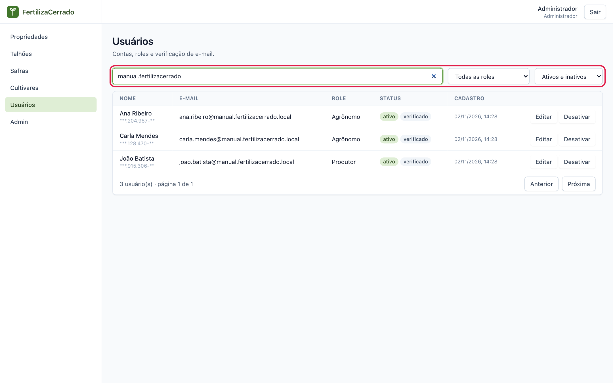
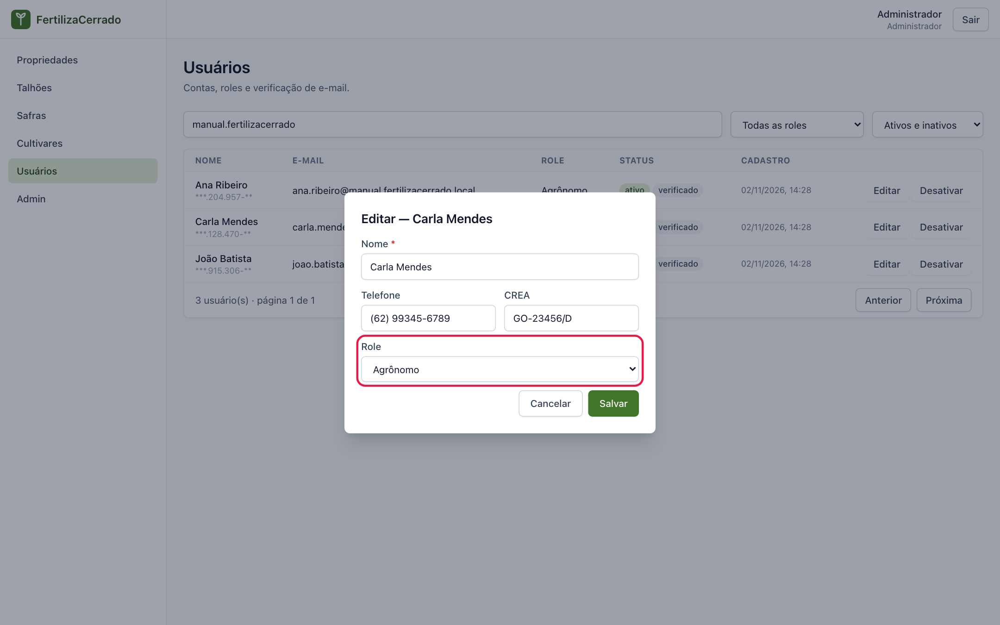
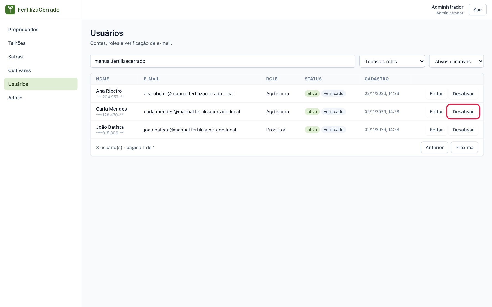
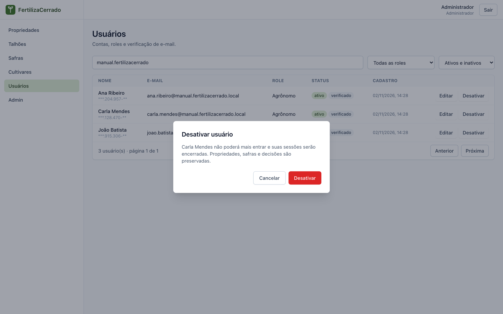
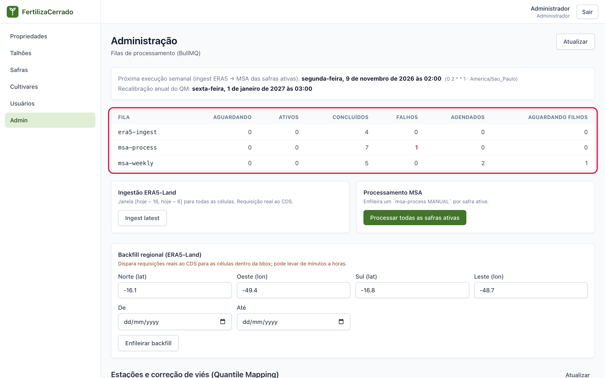
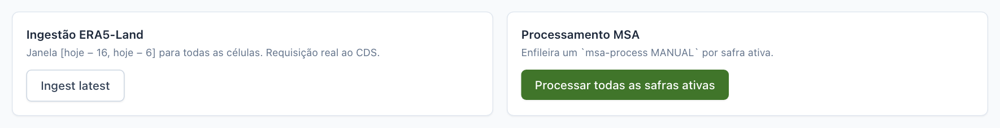
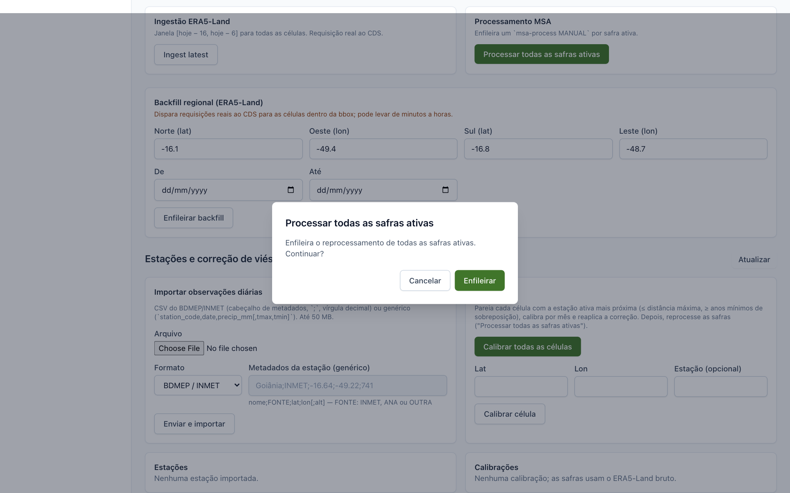
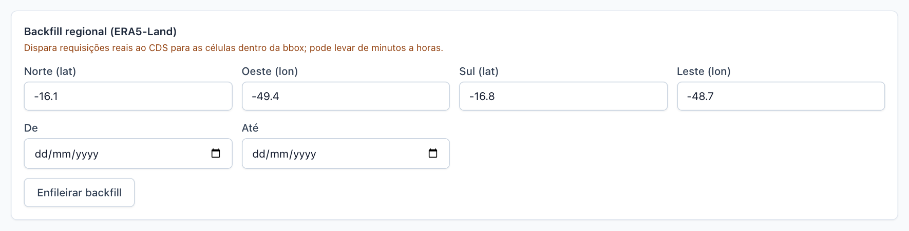
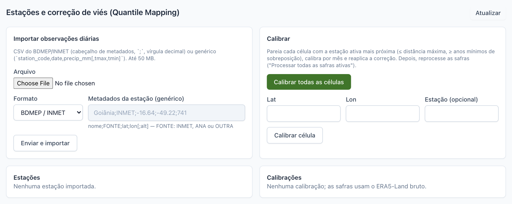

# Administração

**O que você vai fazer:** gerenciar as contas de usuário e acompanhar as rotinas que buscam os dados de clima e processam as safras.
**Quem pode fazer:** somente o administrador.

O administrador vê dois itens a mais no menu: **Usuários** e **Admin**. Ele também enxerga todas as propriedades, talhões e safras do sistema.

Este capítulo usa alguns termos da operação do sistema. **Fila** é a lista de tarefas que o sistema executa em segundo plano, uma depois da outra. **Job** é cada tarefa dessa lista.

## Usuários

### Consultar as contas

1. No menu, clique em **Usuários**. A tabela mostra nome, e-mail, perfil, situação e data de cadastro de cada conta. Na coluna **Role** aparece o perfil.

2. Use o campo **Buscar** para procurar por nome ou e-mail. Os dois seletores ao lado filtram por perfil e por contas ativas ou inativas.

   

Cada linha traz dois selos:

- **ativo** ou **inativo**: se a pessoa pode entrar no sistema;
- **verificado** ou **não verificado**: se ela já confirmou o e-mail.

O documento aparece parcialmente oculto, por proteção de dados.

### Editar uma conta

1. Na linha do usuário, clique em **Editar**.

2. Altere **Nome**, **Telefone**, **CREA** ou **Role**, que é o perfil, e clique em **Salvar**.

   

Mudar o perfil muda na hora o que a pessoa pode ver e fazer. O e-mail e o documento não podem ser alterados. Você não consegue rebaixar o seu próprio perfil.

### Desativar e reativar

Desative a conta de quem não deve mais acessar o sistema, por exemplo um agrônomo que deixou a equipe.

1. Na linha do usuário, clique em **Desativar**.

   

2. Leia a confirmação e clique em **Desativar**.

   

A pessoa é desconectada e não consegue mais entrar. As propriedades e safras dela continuam no sistema. Para devolver o acesso, clique em **Reativar** na mesma linha. A senha continua a mesma.

O sistema não deixa desativar nem rebaixar o último administrador ativo. Assim nunca fica sem ninguém para administrá-lo. Você também não pode desativar a sua própria conta.

### Reenviar a confirmação de e-mail

Nas contas com o selo **não verificado** aparece o botão **Reenviar verificação**. Use-o quando a pessoa disser que não recebeu o e-mail ou que o link venceu.

## A tela Admin

No menu, clique em **Admin**. A tela reúne as rotinas de dados do sistema.

### Como os dados chegam ao painel

O painel de cada safra depende de duas rotinas, que rodam sozinhas toda semana:

1. **Ingestão:** o sistema baixa os dados de clima mais recentes do [ERA5-Land](08-perguntas-e-glossario.md#era5-land) para os quadrados onde há talhões.
2. **Processamento:** com os dados novos, o sistema recalcula o painel de todas as safras ativas.

O topo da tela mostra quando será a **próxima execução semanal** e a tabela de filas.

### Ler a tabela de filas

Cada linha é uma fila e cada coluna conta os jobs em uma situação:

| Coluna | Significado |
|---|---|
| **Aguardando** | Na fila, esperando a vez |
| **Ativos** | Em execução agora |
| **Concluídos** | Terminaram bem |
| **Falhos** | Terminaram com erro |
| **Agendados** | Marcados para rodar mais tarde |
| **Aguardando filhos** | Esperando outra tarefa terminar. O caso típico é o processamento de uma safra esperando a ingestão do clima. |

Em um dia normal, **Aguardando** e **Ativos** ficam em zero ou perto disso. Números crescendo em **Falhos** pedem atenção da equipe técnica. Clique em **Atualizar** para ler os números de novo.

### Ingestão e processamento manuais

Em geral você não precisa disparar nada. Use os botões quando a rotina semanal falhou ou quando quer adiantar a atualização.

- **Ingest latest** baixa os dados de clima dos últimos dias para todos os quadrados em uso. Faz um pedido real ao serviço europeu de dados e pode levar vários minutos.
- **Processar todas as safras ativas** recalcula o painel de cada safra ativa.

Os dois pedem confirmação antes de começar.

Depois de confirmar, a tarefa aparece na tabela **Jobs desta sessão**, no fim da tela, com o estado atualizado a cada poucos segundos.

### Backfill regional

Backfill é o carregamento de dados antigos. Use-o para preparar uma região nova antes de os usuários cadastrarem safras nela. Assim a primeira safra de cada talhão é processada em segundos, e não em muitos minutos.

1. Informe os limites da região em graus: **Norte**, **Oeste**, **Sul** e **Leste**. No Brasil, latitudes e longitudes são números negativos.
2. Informe o período em **De** e **Até**.
3. Clique em **Enfileirar backfill**.

Regiões grandes e períodos longos levam de minutos a horas. Comece por áreas pequenas.

## Estações e calibração da chuva

A chuva é o dado mais incerto do ERA5-Land. Quando existe uma estação meteorológica próxima com vários anos de medições, o sistema usa essas medições para corrigir a chuva estimada. O resultado aparece no painel, no selo de correção da chuva descrito no [capítulo 6](06-painel-agrometeorologico.md#o-selo-de-correção-da-chuva).

### Importar as medições de uma estação

1. Baixe o arquivo de dados diários da estação. O formato mais comum é o do BDMEP, o banco de dados do INMET.
2. Em **Importar observações diárias**, escolha o **Arquivo** e o **Formato**.
3. Para o formato **Genérico**, preencha também os metadados da estação, na ordem indicada abaixo do campo: nome, fonte, latitude, longitude e, se tiver, altitude.
4. Clique em **Enviar e importar**.

A estação passa a aparecer na tabela **Estações**, com a quantidade de dias medidos e o período coberto.

### Calibrar

Depois de importar, clique em **Calibrar todas as células**. Para cada quadrado de clima em uso, o sistema procura a estação ativa mais próxima. Se ela estiver perto o bastante e tiver anos suficientes de medições em comum, o sistema calcula a correção, mês a mês.

Para calibrar um único quadrado, informe **Lat** e **Lon** e clique em **Calibrar célula**.

A tabela **Calibrações** mostra, para cada quadrado, a estação usada, o período, os anos de dados e a distância em quilômetros.

**Depois de calibrar, reprocesse as safras** com **Processar todas as safras ativas**. Só então os painéis passam a usar a chuva corrigida.

Enquanto não houver calibração para um quadrado, as safras dele usam a chuva original do ERA5-Land, e o painel avisa isso. A calibração é refeita sozinha uma vez por ano, com os dados novos das estações. A data aparece no topo da tela, em **Recalibração anual do QM**.

## Boas práticas

- Mantenha pelo menos dois administradores ativos.
- Desative contas em vez de pedir a exclusão. O histórico das safras fica preservado.
- Antes de divulgar o sistema em uma região nova, faça o backfill e, se houver estação, a calibração.
- Olhe a tabela de filas às segundas-feiras, depois da rotina semanal.

---

Capítulo anterior: [Painel agrometeorológico](06-painel-agrometeorologico.md) · Próximo: [Perguntas frequentes e glossário](08-perguntas-e-glossario.md)
